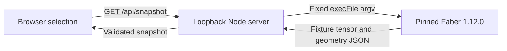

# zchess

A local 8×8×8 chess geometry viewer. Inspect fixture positions and movement previews in sparse 3D or any of three orthogonal 2D slices.

Milestone 1 is implemented and awaiting combined validation, browser review, and aggregate acceptance. This is a geometry review tool: selecting a cell never moves a piece.

## Run locally

Prerequisites:

- Node.js 22 or newer and npm. The local setup used Node 24.22.0 and npm 11.19.1.
- Faber **1.12.0**, installed in this checkout at `.tools/faber/1.12.0/bin/faber`, with its bundled `.tools/faber/1.12.0/share/faber` directory kept beside `bin/`.
- A browser with WebGL support for the 3D view.

Faber is a separate prerequisite; `npm ci` does not install it. This machine already has the pinned compiler. For another checkout, obtain the matching platform archive and published checksum from the [Faber 1.12.0 release](https://github.com/faberlang/releases/releases/tag/faber-v1.12.0), verify the checksum before running it, and extract `bin/` and `share/` together under `.tools/faber/1.12.0/`. The installed macOS Apple Silicon archive is `faber-v1.12.0-aarch64-apple-darwin.tar.gz`; its verified SHA-256 is `140a638385efa4f8209f977159076d634843e047726a544169b371b2b37fbe12`. Do not replace the compiler pin with the latest release or install it globally.

From the repository root:

```sh
.tools/faber/1.12.0/bin/faber --version
npm ci
npm run dev
```

Open the printed URL, normally [http://127.0.0.1:8787](http://127.0.0.1:8787). The server checks the compiler version and current Faber source before printing readiness. There is no browser build step. three.js 0.180.0 is installed from the lockfile and served locally; the browser needs no CDN.

To choose another port:

```sh
PORT=8788 npm run dev
```

The listener binds only to `127.0.0.1`. An occupied requested port causes startup to fail; the server does not silently pick another one. Stop with Ctrl-C. Shutdown cancels active queries. Missing compiler files, source-check errors, and failed queries produce visible errors rather than empty successful boards.

## Review geometry

Choose a fixture, then click a piece or empty cell. The selected coordinate, destination count, and destination coordinates appear below the viewer. Orange/gold marks the selection; green marks destinations. Changing the fixture clears selection. Changing the view, camera, plane, or fixed slice preserves the current selection and preview.

| View | Controls |
| --- | --- |
| 3D pointer | Drag to orbit; right-drag or Shift-drag to pan; wheel to zoom. Click a piece or dot to select. A drag does not select. |
| 3D keyboard | Focus the canvas, then arrows to orbit, WASD to pan, +/− to zoom, R to reset. Form controls retain their normal keyboard behavior. |
| 2D slice | Choose file/rank with fixed tier, file/tier with fixed rank, or rank/tier with fixed file; select the fixed coordinate and click a square. An off-slice selection is reported beneath the slice. |
| Toolbar | Reset camera returns the 3D camera to its initial position; Clear selection removes the preview. |

Coordinates are file A–H, rank 1–8, and tier S–Z. In 3D, X is file, Y is tier/up, and Z is rank/depth. Internal cell identity is `file + 8*rank + 64*tier`, with each component 0–7. Labels use K/Q/R/B/N/P for king/queen/rook/bishop/knight/pawn and show piece color.

The Faber-owned fixture catalog contains `initial`, `rook-center`, `bishop-center`, `queen-center`, `knight-center`, `king-center`, `pawn-white`, `pawn-black`, `pawn-moved`, and `blockers`. The initial fixture uses the provisional 48-piece layout: white back row A1S–H1S, white pawns A1T–H1T and A2T–H2T, black pawns A7Y–H7Y and A8Y–H8Y, and black back row A8Z–H8Z.

Bishops use twelve plane-diagonal directions and exclude body diagonals; that choice and the initial setup remain provisional. Pawns advance along rank or tier separately, with no combined rank+tier advance or capture. Previews account for occupancy but do not enforce king safety.

There is no move application, persistent match, turn enforcement, check/checkmate/stalemate, castling, en passant, or promotion. AI, multiplayer, and public hosting are outside this milestone.

## Local query boundary



Faber reconstructs the fixture and computes every preview from current `src/` files for each request. Node validates transport and response shape, invokes the pinned executable without a shell, and serves `web/` plus fixed local three.js JavaScript assets. It owns no fixture board or movement algorithm. The browser retains presentation and requested fixture/selection identity; it discards stale query responses.

A direct query is [http://127.0.0.1:8787/api/snapshot?fixture=initial&selected=-1](http://127.0.0.1:8787/api/snapshot?fixture=initial&selected=-1). `selected=-1` means unselected; valid cell IDs are 0–511. The bridge allows two simultaneous queries, with a 10-second child timeout and 1 MiB output limit. It rejects malformed requests and non-local Host/Origin values, and cancels children on disconnect or shutdown.

The previous C/raylib runtime and Makefile are retired; git history preserves them. The milestone delivery plan records the combined validation and separate browser witness still required before acceptance.

## License and assets

Newly authored rebuild code and its documentation are MIT licensed; see [LICENSE](LICENSE). Existing `assets/*.png` files are retained with unverified provenance and are excluded from that grant. The viewer generates piece-label billboards rather than loading those PNGs. Third-party tools and dependencies retain their own licenses.
