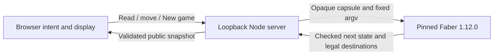

# zchess

An experimental 8×8×8 chess game with Faber-owned rules and a local browser interface. Two players share one screen, with sparse 3D and three orthogonal 2D slice views.

Milestone 2 source implements local legal play; combined runtime validation, browser review and aggregate acceptance are tracked separately. See [the rules](docs/rules.md) and [the delivery plan](docs/plans/milestone-2-delivery.md).

## Run locally

Prerequisites:

- Node.js 22 or newer and npm. The local setup used Node 24.22.0 and npm 11.19.1.
- Faber **1.12.0**, installed in this checkout at `.tools/faber/1.12.0/bin/faber`, with its bundled `.tools/faber/1.12.0/share/faber` directory kept beside `bin/`.
- A browser with WebGL support for the 3D view.

Faber is a separate prerequisite; `npm ci` does not install it. This machine already has the pinned compiler. For another checkout, obtain the matching platform archive and published checksum from the [Faber 1.12.0 release](https://github.com/faberlang/releases/releases/tag/faber-v1.12.0), verify the checksum before running it, and extract `bin/` and `share/` together under `.tools/faber/1.12.0/`. The installed macOS Apple Silicon archive is `faber-v1.12.0-aarch64-apple-darwin.tar.gz`; its verified SHA-256 is `140a638385efa4f8209f977159076d634843e047726a544169b371b2b37fbe12`. Do not replace the compiler pin with the latest release or install it globally.

From the repository root:

```sh
.tools/faber/1.12.0/bin/faber --version
npm ci
npm run dev
```

Open the printed URL, normally [http://127.0.0.1:8787](http://127.0.0.1:8787). The server checks the compiler version and current Faber source before printing readiness. There is no browser build step. three.js 0.180.0 is installed from the lockfile and served locally; the browser needs no CDN.

To choose another port:

```sh
PORT=8788 npm run dev
```

The listener binds only to `127.0.0.1`. An occupied requested port causes startup to fail; the server does not silently pick another one. Stop with Ctrl-C. Shutdown stops child processes and discards the memory-only match. Missing compiler files, source-check errors, and failed queries produce visible errors rather than empty successful boards.

## Play locally

The default **Play** mode reads the existing shared match. White moves first. Click your piece, then a green highlighted destination. If promotion is offered, choose Queen, Rook, Bishop or Knight; **Cancel** leaves the position unchanged. The readout shows whose turn it is, check or the final result, and the last move.

**New game** explicitly resets the match. Refreshing the page or switching modes does not reset it. Every tab connected to the same server shares one match; another tab's action can make your displayed position stale. A rejected stale action refreshes the position and requires a new click, without replaying the action. There is no automatic cross-tab live refresh.

The match lasts only while the local server runs: stopping or restarting it loses the game. There is no save/resume, undo, AI, online matchmaking or public hosting. Checkmate and stalemate are implemented; repetition, move-count and insufficient-material draws are deferred.

Choose **Geometry sandbox** to inspect fixed fixture positions without changing the match. Click a piece or empty cell to see occupancy-aware movement previews; sandbox previews do not enforce turns or king safety. Returning to Play reads the shared match again.

Orange/gold marks selection; green marks supplied destinations. Coordinates, destination count and destinations appear below the viewer. View, camera, plane, slice and piece-style changes preserve selection and never submit moves.

| View | Controls |
| --- | --- |
| 3D pointer | Drag to orbit; right-drag or Shift-drag to pan; wheel to zoom. Click a piece or dot to select. A drag does not select. |
| 3D keyboard | Focus the canvas, then arrows to orbit, WASD to pan, +/− to zoom, R to reset. Form controls retain their normal keyboard behavior. |
| 2D slice | Choose file/rank with fixed tier, file/tier with fixed rank, or rank/tier with fixed file; select the fixed coordinate and click a square. An off-slice selection is reported beneath the slice. |
| Toolbar | Pieces defaults to Sprites; choose Text for letter labels or image-load recovery. Style changes preserve the current selection and camera without a new query. Reset camera returns the 3D camera to its initial position; Clear selection removes the preview. |

Coordinates are file A–H, rank 1–8, and tier S–Z. In 3D, X is file, Y is tier/up, and Z is rank/depth. Internal cell identity is `file + 8*rank + 64*tier`, with each component 0–7. Labels use K/Q/R/B/N/P for king/queen/rook/bishop/knight/pawn and show piece color.

The Faber-owned fixture catalog contains `initial`, `rook-center`, `bishop-center`, `queen-center`, `knight-center`, `king-center`, `pawn-white`, `pawn-black`, `pawn-moved`, and `blockers`. The initial fixture uses the provisional 48-piece layout: white back row A1S–H1S, white pawns A1T–H1T and A2T–H2T, black pawns A7Y–H7Y and A8Y–H8Y, and black back row A8Z–H8Z.

The initial setup and piece movement choices are current experimental rules, retained for now. See [rules and special moves](docs/rules.md) for their exact meaning.

## Local state boundary



Faber owns the tensor, turn, rights, move legality, king safety and result. It encodes and validates the complete match between CLI calls. Node holds the latest opaque capsule and Faber-supplied revision in memory; it never calculates a move or decodes the capsule's chess fields. The browser retains presentation and selection, discards stale reads, and waits for confirmed state rather than moving pieces optimistically.

`GET /api/match?selected=-1` reads the current match. Mutation routes are `POST /api/match/move` and `POST /api/match/new`, with session and revision checks. Match work is serialized; there are at most four accepted match items including active work, and at most two Faber children globally. Children have a 10-second timeout and 1 MiB output limit. A dispatched match action finishes even if its caller disconnects; a fresh read retrieves the retained result. Mutations are never automatically retried. Host/Origin checks restrict the local boundary; this is not an internet deployment design.

The geometry endpoint remains [GET /api/snapshot?fixture=initial&selected=-1](http://127.0.0.1:8787/api/snapshot?fixture=initial&selected=-1). It reconstructs an independent fixture for each query. Cell IDs are 0–511; −1 means unselected. Node serves `web/`, the fixed PNG allowlist and local three.js assets. No CDN or C/raylib runtime is used; Git history retains the retired C prototype.

## Validation and compiler limits

The delivery plan assigns full Faber/Node integration checks and a separate real-browser witness. Source implementation and narrow unit receipts do not themselves establish a complete browser acceptance pass; see `docs/evidence/` for recorded observations.

Faber remains pinned to 1.12.0. Its formatter previously refused the working imported preview assignment in `src/arena.fab` with `SEM010`, while the package check and CLI query passed. That formatter limitation is recorded in [the follow-up evidence](docs/evidence/m1-format-followup.md); it is not a passing formatter gate. Restrict formatting to `src`, since formatting the repository root traverses ignored tool files. Do not upgrade the compiler or apply the documented runtime-breaking cast workaround to hide this diagnostic.

## License and assets

Newly authored rebuild code and its documentation are MIT licensed; see [LICENSE](LICENSE). Existing `assets/*.png` files are retained with unverified provenance and are excluded from that grant. The local viewer uses those PNGs by default in both views, with generated piece labels available through the Text option. Third-party tools and dependencies retain their own licenses.
