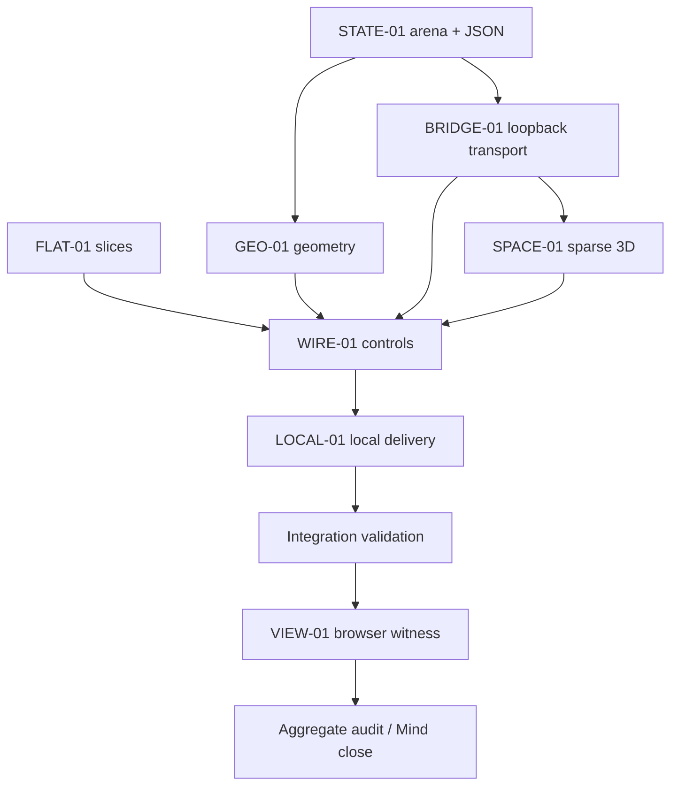

# Milestone 1: local arena geometry viewer

Status: delivered for operator geometry review; integrated checks and bounded real-browser witness recorded, aggregate audit and targeted repair review accepted. Pinned formatter limitation is tracked before CI; no playable-game acceptance claimed.
Goal: `docs/plans/zchess-rebuild.md`; revision task `82446a20`.
Every unit writes only `/Users/sterling/Documents/dev/workspaces/personal/zchess` on `codex/faber-rebuild`. Original C base: `aced8a5`; initial planning: `97f73de`.

## Outcome and evidenced boundary

Deliver the approved geometry viewer: Faber-owned fixture positions and movement previews, sparse manipulable 3D, and all three orthogonal 2D slice planes. No match state, move application or full legal game exists in M1. Preserve the complete future rules and provisional decisions in the goal.

ENV-01 (`431c1006`) proves installed/checksummed 1.12.0 at `.tools/faber/1.12.0/bin/faber`, explicit `ti8[8,8,8]` creation/indexing, ranges and a tensor test. ENV-02 (`27e9f381`) proves pinned CLI stdout parsed by Node. Generated TS remains blocked (missing runtime, no emitted export); do not reproduce probes or pursue that route. Node HTTP and browser integration remain unproved product work.

The revision's only new narrow probe is `.tools/probes/planner-abi/`: package manifest with name/version/edition, `[paths] source="src", entry="main.fab"`, `[build] kind="bin"`; `import from "./echo" echo`; sibling `@ public fn identity(i32 value) → i32`. It checks and runs with `--locale en`, with WARN003 on the imported function despite successful invocation. The executable entry is:

```faber
@ cli "planner-abi"
@ operand string fixture description "Fixture identifier"
@ operand string selected description "Selected cell"
main args args {
    const i32 selected ← args.selected ↦ i32
    print args.fixture
    print echo.identity(selected)
}
```

Executed commands (not product checks):

```sh
.tools/faber/1.12.0/bin/faber check --locale en .tools/probes/planner-abi
.tools/faber/1.12.0/bin/faber run --locale en .tools/probes/planner-abi -- initial 227
.tools/faber/1.12.0/bin/faber run --locale en .tools/probes/planner-abi -- initial -1
```

Check exits 0; runs print `initial` followed by `227` or `-1`, each on its own line. Package-level `locale="en"` was rejected as an unknown manifest field; `@ operand i32` was rejected SEM009. Use explicit `--locale en`, string operands and checked conversion. Input `nope` exits 1 on numeric conversion. This proves argv and sibling function imports, not arbitrary package APIs or the complete JSON serializer. `faber test --help` confirms `.proba` include filtering; no existing ENV test was rerun.

## Exact process, HTTP and renderer contract

Node uses `execFile` with the absolute pinned binary, fixed repository working directory, and argument array `['run','--locale','en',ROOT,'--',fixture,String(selected)]`. No shell, interpolated command, generated source or user-selected executable/path. A fresh invocation reconstructs the fixture and computes targets; it writes one complete JSON object to stdout after all validation. Diagnostics stay on stderr. No game state survives the request.

Faber main uses the two string operands shown above. `fixture` is a known fixture ID; `selected` is decimal `-1` (nothing selected) or a cell ID 0–511. Faber validates both and rejects unknown fixtures/out-of-bounds selection. The host may validate syntax/range for transport but cannot construct boards or moves.

HTTP endpoint: `GET /api/snapshot?fixture=initial&selected=-1`, both query keys required exactly once. Success HTTP 200 / `application/json`:

```json
{"ok":true,"snapshot":{"schemaVersion":1,"fixtureId":"initial","fixtures":["initial","rook-center","bishop-center","queen-center","knight-center","king-center","pawn-white","pawn-black","pawn-moved","blockers"],"selected":-1,"cells":[],"moved":[],"destinations":[]}}
```

The empty arrays above illustrate field names only. Every real success MUST contain exactly 512 integer `cells` and 512 binary `moved` values; `destinations` is a sorted unique list of IDs. Faber owns the fixture catalog returned in `fixtures`; no host fixture-position table is permitted. Cell identity is `file + 8*rank + 64*tier`, each component 0–7; tensor index is `[file,rank,tier]`, not assumed backing-store order. Board type is `ti8[8,8,8]`. Codes: 0 empty; abs(1 king, 2 queen, 3 rook, 4 bishop, 5 knight, 6 pawn); positive white, negative black. Separate moved metadata uses 0 unmoved / 1 moved. A selected empty cell is echoed with empty destinations. Unselected is always -1, never null.

Faber semantic error: `{"ok":false,"error":{"code":"UNKNOWN_FIXTURE","message":"Unknown fixture"}}`; use `INVALID_SELECTION` for selection errors. Both are HTTP 400. Node returns the same envelope with transport codes: 400 `INVALID_REQUEST` (malformed/missing/duplicate query), 503 `BUSY` (concurrency limit), 504 `FABER_TIMEOUT`, 502 `FABER_FAILURE` or `INVALID_FABER_JSON`; error details do not become a fake empty snapshot. Nonzero child exit or malformed JSON can never be success. Limit child wall time to 10 seconds and stdout to 1 MiB; at most two child queries at once, no unbounded queue. Kill children on client disconnect/server shutdown. Bound loopback responses with no CORS opt-in; reject non-local Host/Origin for API requests.

Browser keeps only requested fixture/selected identity plus camera, plane, fixed-axis index, hover and request generation. It renders detached responses. On fixture switch request selection -1. Discard late responses from older requests; pending/error states must not present old highlights as current. Camera/slice/view changes do not query or alter board rules. Both views implement `createView(container, onSelect) → {render(snapshot, presentation), resetCamera(), dispose()}`; 2D `resetCamera` is a no-op. Modules are plain `.mjs`, production modules never import tests. Renderers receive this contract, with test-only fabricated snapshots allowed.

Faber fixtures: exact initial 48-piece C layout; each centered nonpawn piece; both pawn colors with forward lanes and enemy captures; moved pawn; friendly/enemy ray blockers. Full geometry definitions remain in the goal. No castling, en passant, promotion, king safety or actual moves in M1.

## Unit graph



Independent delivery audit precedes every dispatch. STATE-01 and FLAT-01 can start immediately after audit; GEO-01 and BRIDGE-01 can then run on disjoint files. Do not run shared Faber toolchains concurrently. All units are non-integrable alone until the M1 gate/witness; no new branch, push or merge is implied. Future checks below are unexecuted product requirements, not planning receipts.

## Implementation units

Each row has one definition. Scopes are exact repo-relative files. Read scope: repo, accepted receipts and cited language references. A Hand runs only its narrow sanity and reports executed cases; broad checks belong to the integration owner.

### STATE-01 — Faber fixture snapshots

- **outcome:** Pure fixture/selection queries emit the exact JSON envelope from actual Faber tensor state.
- **write_scope:** `faber.toml`, `src/main.fab`, `src/arena.fab`, `src/geometry.fab`, `src/arena.proba`.
- **depends_on:** none, after delivery audit and accepted ENV receipts.
- **done_when:** Use the proven manifest/import/argv shape. Arena owns tensor, separate moved metadata, fixture catalog/layouts, input validation and JSON serialization; main only parses operands and calls it. Export `arena.snapshot(string fixture, i32 selected) → string` as the complete JSON envelope; `arena` imports `geometry`. Create `@ public fn previews(ti8[8,8,8] board, list<i8> moved, i32 selected) → list<i32>` in geometry as a typed empty stub, to be replaced only by GEO-01. Validate before printing; stdout contains no prompts/debug/partial JSON. Test explicit coordinate flattening, exact initial positions, invalid input, empty/unselected cases and deterministic repeated queries. No persistent state or public game action.
- **sanity:** `.tools/faber/1.12.0/bin/faber test --locale en . --include arena`; require nonzero executed cases. One CLI stdout parsed with Node must satisfy the exact schema and initial occupancy; this is the unit boundary, not HTTP/browser proof.
- **non_goals:** Movement implementation beyond typed stub, Node server, rendering, C deletion.
- **risk:** medium: imported tensor/list API and full serializer exceed the minimal probe. Report exact unsupported mechanism instead of changing language or moving rules to JS.
- **integrable:** no.

### GEO-01 — Faber movement previews

- **outcome:** All six occupancy-aware preview families replace the geometry stub.
- **write_scope:** `src/geometry.fab`, `src/geometry.proba`.
- **depends_on:** STATE-01.
- **done_when:** Preserve `previews` signature and readonly input semantics. Enforce bounds, unique sorted IDs, no origin, correct blocker behavior; rook six rays, provisional bishop twelve plane rays/no body diagonals, queen union, all twenty-four knight jumps, king twenty-six neighbors, and both pawn colors/axes with moved-state and clear intermediate checks. Capture only occupied enemy file+rank OR file+tier cells. No combined rank+tier advance/capture or full legality.
- **sanity:** `.tools/faber/1.12.0/bin/faber test --locale en . --include geometry`; require nonzero cases covering center/edge/corner, friendly/enemy blockers, jumping knights, pawn axes/colors/moved/empty captures, and input nonmutation. Mathematical witnesses must not simply copy the generation algorithm.
- **non_goals:** Move execution, check, special moves, rule redesign.
- **risk:** medium: missing direction families can look plausible visually.
- **integrable:** no.

### BRIDGE-01 — bounded loopback transport

- **outcome:** Plain Node serves browser modules/local three.js and translates fixture queries to pinned Faber without state ownership.
- **write_scope:** `scripts/serve.mjs`, `scripts/serve.test.mjs`, `package.json`, `package-lock.json`, `.gitignore`.
- **depends_on:** STATE-01.
- **done_when:** Implement the process/HTTP contract above; absolute fixed executable/root, no shell, bounded children, validated output/error envelopes, current-source invocation, disconnect/shutdown cleanup. Serve only `web/` and a fixed `/vendor/three/` mapping to installed three.js JS assets; normalize/contain paths, reject traversal and never expose repo/tools. Bind 127.0.0.1, use `PORT` or default 8787, refuse a busy requested port, print actual ready URL only after listening. Pin one three.js npm version and lock it; no framework, Vite, TypeScript, bundler or runtime shim. Establish `npm run dev` as this server entry; no mandatory build step. A startup compiler version/check failure prevents readiness.
- **sanity:** `node --test scripts/serve.test.mjs`; use an ephemeral loopback test port and actual Faber for a valid query, bad query/fixture and schema checks; injected child seam only for timeout/failure/output-limit/disconnect tests. Verify static traversal rejection and port collision. Report cases and stop all test children.
- **non_goals:** Persistent sessions, actions, arbitrary subprocess/API surface, authentication system, public listener, rendering or geometry.
- **risk:** medium: process lifecycle, boundary errors and source-file exposure.
- **integrable:** no.

### FLAT-01 — orthogonal Canvas2D slices

- **outcome:** Supplied snapshots draw and pick consistently in three slice planes.
- **write_scope:** `web/slices.mjs`, `web/slices.test.mjs`.
- **depends_on:** none, after delivery audit; uses the fixed contract above.
- **done_when:** Implement the shared view interface for file/rank fixed tier, file/tier fixed rank, rank/tier fixed file. Show axis labels, readable pieces/colors, selected cell and supplied targets; off-slice selection remains explicit. Bijective 64-cell picking per slice with consistent axes, resize/device-pixel-ratio handling and disposal. Return cell IDs only; no candidate generation.
- **sanity:** `node --test web/slices.test.mjs`; round-trip every visible cell for all planes/fixed-axis extremes and supplied selection/target projection. Importing the testable math must not require a browser DOM.
- **non_goals:** Faber/server/fixture ownership, 3D, app controls or actual moves.
- **risk:** medium: plausible axis-transposition errors.
- **integrable:** no.

### SPACE-01 — sparse 3D with pointer and keyboard controls

- **outcome:** Thin three.js dots and camera-facing generated piece-label sprites render and pick supplied snapshots.
- **write_scope:** `web/space.mjs`, `web/space.test.mjs`.
- **depends_on:** BRIDGE-01 for pinned local three.js dependency/asset route.
- **done_when:** Shared view interface; world file=X, tier=Y up, rank=Z depth, centered arena. Orbit/pan/zoom/reset by pointer; focused canvas supports arrows orbit, WASD pan, +/- zoom and R reset, with visible help and no keyboard interception in form controls. Pick exact piece/empty-dot IDs without drag-as-click, show selection/targets/axes, handle resize and dispose GPU/listener resources. Clear 3D initialization error. Import three.js via browser import map/local vendor route; no CDN/runtime fetch. Generated billboards avoid assuming PNG provenance.
- **sanity:** `node --test web/space.test.mjs`; coordinate identity, picking identity, keyboard-to-camera intent and drag-vs-click logic. Keep testable logic importable under Node; full WebGL/browser proof belongs to VIEW-01.
- **non_goals:** Rules, WebGPU/Triga, custom shaders, app controls or visual polish.
- **risk:** medium: depth/occlusion, picking and focus errors.
- **integrable:** no.

### WIRE-01 — shared geometry-review workflow

- **outcome:** Connect real HTTP snapshots to both renderers and visible review controls.
- **write_scope:** `web/index.html`, `web/main.mjs`, `web/style.css`, `web/controller.mjs`, `web/controller.test.mjs`.
- **depends_on:** GEO-01, BRIDGE-01, FLAT-01, SPACE-01.
- **done_when:** Initial query fetches fixture catalog; fixture selector, view selector, plane/fixed-axis controls, camera reset, coordinate readout and supplied targets/count work. One click makes one query; fixture switch selects -1; late replies never restore an old selection. Loading/errors are visible and stale highlights are cleared. View/camera/slice changes preserve query identity without recomputing rules. Import map points bare `three` at the local vendor path. Visible geometry disclaimer, provisional bishop/setup labels and excluded pawn combination; no playable-game controls.
- **sanity:** `node --test web/controller.test.mjs`; command/query forwarding, empty selection, fixture change, out-of-order responses, failure/loading and view changes without a board/rules mutation. Fake transport is test-only, never production fixture data.
- **non_goals:** Legal moves, persistence, new rules, app redesign.
- **risk:** medium: race/stale-state errors can falsely describe geometry.
- **integrable:** no.

### LOCAL-01 — reproducible local delivery and retirement

- **outcome:** Document/finish the local launch boundary and retire the old C runtime at integration.
- **write_scope:** `README.md`, `LICENSE`, `package.json`, `.gitignore`; delete only `Makefile`, `src/engine.c`, `src/engine.h`, `src/zchess.c`.
- **depends_on:** WIRE-01.
- **done_when:** README gives exact pinned compiler path/install prerequisite, Node/npm prerequisite, `npm ci` and `npm run dev`, loopback URL, controls including keyboard, local query architecture, fixtures and missing legal-game features. New authored code MIT; existing PNG provenance is excluded. Tools/node_modules remain ignored. Remove only the C inventory below, keeping history and optional sprites. No browser build/package ceremony or CI is introduced; future v1 CI remains in the goal.
- **sanity:** Inspect exact retirement diff and README commands against server/package scripts. Broad package/query/browser checks belong to the owners below, not this Hand.
- **non_goals:** Global install/PATH changes, PNG deletion, archive copy, public hosting, remote mutation.
- **risk:** low: source retirement must not precede the working replacement's integration gate.
- **integrable:** no until integrated validation and viewer witness pass.

## Integration owner and separate VIEW-01 witness

After seven units, Mind names one validation owner to run the broad hygiene once: `npm ci`; `.tools/faber/1.12.0/bin/faber format --check src`; `.tools/faber/1.12.0/bin/faber check --locale en .`; `.tools/faber/1.12.0/bin/faber test --locale en .`; `node --test scripts/serve.test.mjs web/slices.test.mjs web/space.test.mjs web/controller.test.mjs`. Installed format help confirms `--check` is read-only and defaults to English when no locale frontmatter/manifest pin exists; it has no `--locale` flag. Record exact commands, cases and results in `docs/evidence/m1-validation.md`; a zero-test pass is not proof. Check plain JS syntax as part of host tests, no unexplained new lint/build dependency. No compiler export/runtime build is required. Do not rerun accepted ENV probes or duplicate every unit sanity without a changed seam or named concern; the integration pass proves only the combined tree.

VIEW-01 is a separately assigned read-only product witness after that gate; write only `docs/evidence/m1-viewer-acceptance.md`. Record commit/source, launch command, actual URL, browser/version and observed results:

1. Follow README; open initial setup, identify A1S/E1S and A8Z/E8Z plus pawn tiers. Reload, stop/relaunch, confirm current source is queried and all processes stop cleanly.
2. Select each isolated piece/pawn/moved/blocker fixture. Compare selected/target IDs to real HTTP JSON from Faber, not a host rules algorithm.
3. Pointer orbit/pan/zoom/reset and piece/empty-dot picking; dragging must not select. Focus canvas and exercise arrows/WASD/+/-/R; controls must leave form typing alone.
4. Carry one preview through all slice planes/fixed-axis extremes and view changes. Visible markers must be the projection of the same IDs; outside-slice status must be clear.
5. Switch fixtures quickly, then select empty space; no late/stale highlights. Check labels/disclaimer, resize, a malformed request, an unknown fixture, busy port and a failed Faber request. Error states cannot masquerade as success.

No exhaustive browser automation or repeated rules suite. A passing witness proves technical viewability, not operator settlement of provisional rules. Independent aggregate audit reviews the landed range/receipts before Mind closes M1. No push, merge or deploy is assigned here.

## Retirement inventory and stop conditions

This read-only baseline command was executed and must be rechecked before deleting anything:

```sh
git ls-files '*.c' '*.h' Makefile
```

Complete output:

```text
Makefile
src/engine.c
src/engine.h
src/zchess.c
```

Every unit preserves state/rules in Faber and the fixed JSON/identity contract. Stop for a required language upgrade, JS board/movement implementation, persistent match/server design, generated-output patching or new rule decision. Full JSON/package integration failure gets its precise diagnostic routed to Mind; successful minimal imports do not promise every imported type works. Existing .tools/ENV evidence remains untouched. No product implementation or Hand task creation is performed by this planner revision.
