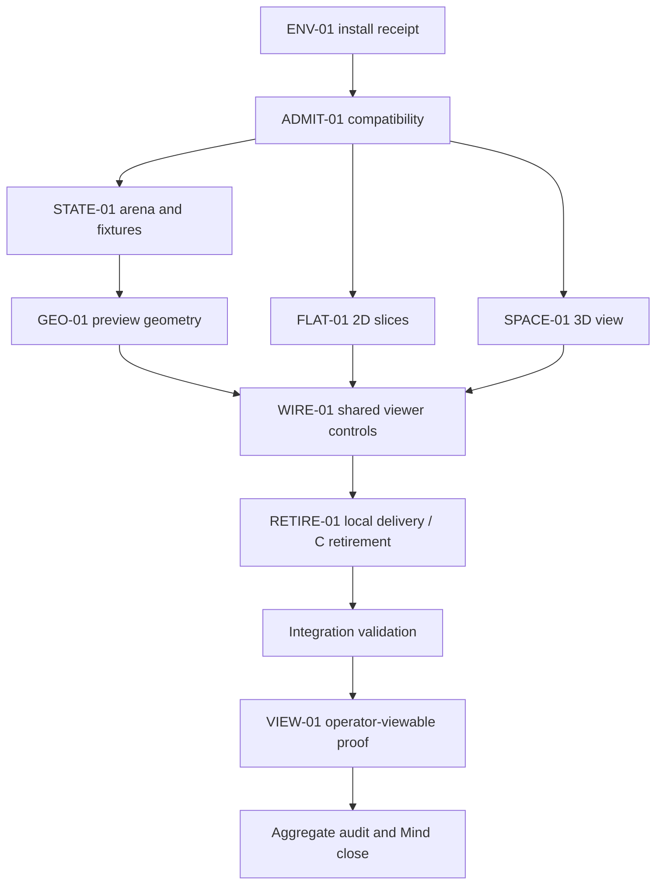

# Milestone 1: arena geometry viewer delivery

Status: planned; compatibility and independent delivery audit pending.
Goal: `docs/plans/zchess-rebuild.md` (planner READY for gated delivery).
Repository for every unit: `/Users/sterling/Documents/dev/workspaces/personal/zchess`.
Base: `aced8a5`; development branch `codex/faber-rebuild`.

## Delivery outcome and baseline

Deliver a reliable local viewer whose arena, fixtures and movement previews are authored in English Faber 1.12.0. Compare sparse manipulable 3D against file/rank, file/tier and rank/tier slices. This is a geometry review tool; no actual chess moves, turns or full legality yet. Rule definitions and provisional status are in the goal and must not be widened.

Only C/raylib and PNGs exist at the base. The public example paths are currently unavailable; live docs disagree about browser package support. Therefore the first unit is compatibility diagnosis/admission, not assumed infrastructure. ENV-01 owns installation; no unit duplicates it. New file paths below are a proposed implementation layout, not claims about existing files.

### Verified retirement inventory

The following read-only command was executed at the base:

```sh
git ls-files '*.c' '*.h' Makefile
```

Complete output:

```text
Makefile
src/engine.c
src/engine.h
src/zchess.c
```

Only RETIRE-01 may delete these exact files. Their replacement is atomic at integration: do not publish a half-built replacement. Retain the PNG assets; use generated text billboards initially. Do not archive C into a new folder.

## Shared interfaces and invariants

The admission unit proves the mechanism and records the exact pinned CLI flags/artifacts before other units start. It may refine emitted representation names, but must preserve this semantic contract:

- Faber owns a `tensor<i32,[8,8,8]>` piece grid indexed by `[file,rank,tier]`, plus a separate 512-element moved-metadata list. Code 0 is empty; absolute codes 1 king, 2 queen, 3 rook, 4 bishop, 5 knight, 6 pawn; positive white, negative black.
- Browser cell identity is `id = file + 8*rank + 64*tier`, 0–511. Flattening uses that explicit formula rather than assuming tensor backing-store order. Label conversions are presentation only.
- Faber public operations, with spellings translated by a representation-only adapter if emitted names differ: `loadPosition(id: string)`, `selectCell(id: int)`, and `snapshot()`. Faber stores current fixture and selected cell; invalid external cell/fixture input returns an explicit error and leaves state unchanged.
- Snapshot is a detached read model: `{fixtureId, cells: number[512], moved: boolean[512], selected: number|null, destinations: number[]}`. `destinations` are unique IDs from Faber. The host must not mutate the Faber grid, calculate candidate moves, mirror moved state, or infer rules from coordinates.
- Each command produces a fresh snapshot; fixture load clears selection and destinations. Selecting an empty cell selects its coordinate with no destinations. The operator may inspect either color with no side-to-move restriction in M1.
- Host owns camera, active view, slice plane/index and hover. It forwards one cell ID on click. View switches preserve the selected identity and preview set. A selected cell outside a slice remains visible in the coordinate readout with an off-slice notice.
- Fixtures are Faber-authored: initial, rook-center, bishop-center, queen-center, knight-center, king-center, pawn-white, pawn-black, pawn-moved, and blockers. Pawn fixtures contain enemy capture witnesses and clear noncapture lanes. Blockers exercises friendly and enemy ray stopping. Positions are review examples, not legal-game positions.
- Faber geometry uses only the agreed directions and occupancy semantics in the goal. King safety and special moves are absent; no move-application function is exposed.
- New sources must remain regenerable from Faber. Never patch emitted TypeScript/JS or add rules to the host to rescue a failed target.



ENV-01 is existing external work, not a new Hand. The downstream arrows are hard dependencies. FLAT-01 and SPACE-01 may run concurrently with Faber work after admission because their write surfaces are disjoint; they receive a fabricated snapshot solely in their tests, never as a production rules implementation. Serial shared state: only one unit at a time edits a given file or runs a Faber/native toolchain in this checkout.

## Implementation units

All write scopes are repository-relative within the root above. Unless stated otherwise, read scope is unrestricted within the repo and cited primary docs. No Hand owns a full package build or full suite. A sanity receipt must report the tests actually executed, not merely an exit status. Commands below are **future unexecuted contracts**; do not present them as passed planning checks.

### ADMIT-01 — prove pinned tensor-to-browser compatibility

- **outcome:** A narrow working package/build adapter establishes that Faber 1.12.0 can own tensor state and expose state changes to a real local browser.
- **write_scope:** `faber.toml`, `src/main.fab`, `src/arena.fab`, `src/geometry.fab`, `package.json`, `package-lock.json`, `tsconfig.json`, `vite.config.ts`, `scripts/build-faber.mjs`, `web/index.html`, `web/src/faber-adapter.ts`, `web/src/contract.ts`, `web/src/admission.ts`, `docs/evidence/m1-compatibility.md`, `.gitignore`.
- **depends_on:** ENV-01 installation receipt; independent delivery audit before dispatch.
- **done_when:** Pin verified compiler launcher/version and host dependency versions/lock. Read local build/emit help rather than guessing browser-product flags. A minimal English tensor module with independent metadata and a public function checks, emits, bundles without generated edits, and a browser click changes a Faber cell from empty to a known piece and reads it back after another call. Prove coordinate sentinels for (1,2,3) and (3,2,1), separating tensor indexing from wire flattening. Exercise explicit invalid input and state preservation. Keep `geometry.fab` a typed empty-preview stub until GEO-01. Record actual commands, artifact paths, browser/version, observable output, external runtime provenance and any install requirement. Establish the shared contract and npm scripts named below; default rendering dependencies are three.js plus Vite/TypeScript, without UI framework, Triga or Tela.
- **sanity:** One scoped admission probe plus one real browser interaction; this is the feature of the unit, not a full viewer proof. `npm run probe:compat` must exercise actual generated Faber and fail on a mismatch.
- **non_goals:** Full initial setup, full geometry, polished viewer, installation duplication, compiler fixes, alternate Faber versions, native server rules fallback.
- **risk:** high: docs do not prove pinned emission/export/runtime assembly. Report PASS only for the named tensor/export/browser mechanism. Report other errors verbatim as residuals. If that signal cannot run, report INCONCLUSIVE with the structural reason; if it fails, report the exact failed contract. Stop downstream dispatch on FAIL/INCONCLUSIVE.
- **integrable:** no; scaffold remains on development branch until full M1 integration.

### STATE-01 — arena authority and inspectable fixtures

- **outcome:** Replace admission sample state with actual Faber arena, metadata, fixture loading, selection and detached snapshots.
- **write_scope:** `src/arena.fab`, `src/main.fab`, `tests/arena.fab`.
- **depends_on:** ADMIT-01.
- **done_when:** Implement exact signed codes/coordinates/snapshot semantics above. Initial setup matches the 48-piece C table before retirement. Supply each named fixture and deterministic reset; selected cell is cleared on fixture switch, empty selection yields no targets, invalid inputs preserve state. Import the geometry stub for snapshot destinations; do not calculate rules here.
- **sanity:** `npm run test:arena`, selecting this file only. Test initial piece/color positions, empty cells, coordinate sentinels, moved metadata, fixture reset, invalid input and snapshot isolation; record nonzero executed test cases. ADMIT-01 must establish the actual Faber test filter or dedicated harness behind this command.
- **non_goals:** Movement logic, move execution, turn/history/persistence, rendering, direct grid mutation by host.
- **risk:** medium: mutable tensor aliasing and flattening could break both views.
- **integrable:** no.

### GEO-01 — occupancy-aware preview geometry

- **outcome:** Implement all six agreed geometry families in Faber against the existing state contract.
- **write_scope:** `src/geometry.fab`, `tests/geometry.fab`.
- **depends_on:** STATE-01.
- **done_when:** The goal's directions, bounds, origin exclusion, occupancy stops and duplicate exclusion hold. The provisional bishop has no body diagonals; queen is exact rook/bishop union; knight jumps cover every signed permutation. Pawns distinguish color, moved/unmoved and each axis, require clear double-step intermediate, and capture only occupied enemy file+rank OR file+tier diagonals. No combined rank+tier advance/capture or full-check filtering. Input state is not mutated by previews.
- **sanity:** `npm run test:geometry`, selecting this file only. Include center/edge/corner witnesses, friendly/enemy ray blocks, knights over blockers, both pawn colors/axes, moved pawn double-step exclusion and empty capture squares; record nonzero test cases. The test owns the mathematical sets, not a copy of the implementation algorithm.
- **non_goals:** Castling, en passant, promotion, check, move execution, redefining provisional rules.
- **risk:** medium: an attractive drawing can conceal incomplete direction sets.
- **integrable:** no.

### FLAT-01 — three orthogonal slice projections

- **outcome:** A Canvas2D slice view draws a supplied shared snapshot and reports the exact clicked cell ID.
- **write_scope:** `web/src/slices.ts`, `web/src/slices.test.ts`.
- **depends_on:** ADMIT-01.
- **done_when:** Support file/rank fixed tier, file/tier fixed rank, and rank/tier fixed file. Show axis labels, visible pieces, selected cell and supplied destinations; distinguish occupied targets/readable piece colors. Map all 64 visible cells bijectively to the chosen plane with consistent rank/tier orientation. Handle resize and device pixel ratio; do not generate moves. Return click identity via callback; expose render/dispose methods, no global state.
- **sanity:** `npm run test:slices`, selecting this file only; round-trip projection/picking for every slice plane and fixed-axis extreme, plus selection/target inclusion from supplied IDs.
- **non_goals:** Faber imports, fixture ownership, move execution, 3D, app controls.
- **risk:** medium: axis transposition can produce plausible wrong highlights.
- **integrable:** no.

### SPACE-01 — sparse selectable 3D arena

- **outcome:** A thin three.js view draws supplied cells as sparse dots and camera-facing piece-label billboards.
- **write_scope:** `web/src/space.ts`, `web/src/space.test.ts`.
- **depends_on:** ADMIT-01.
- **done_when:** World axes are file X, rank depth Z, tier up Y, centered on arena midpoint. Orbit/pan/zoom/reset, selected/target markers and axes are readable. Pieces use generated text textures; ray picking returns exact cell IDs for piece sprites and empty dots without drag-as-click. Handle resize and dispose GPU/listener resources; show a clear initialization error if 3D cannot start. Render only the supplied snapshot and never compute rules.
- **sanity:** `npm run test:space`, selecting this file only; coordinate/world round-trip, stable object-to-cell identity and drag/click classification. A minimal manual 3D sanity is allowed; full acceptance belongs to VIEW-01.
- **non_goals:** WebGPU/Triga, custom shader system, PNG licensing assumptions, app/fixture controls.
- **risk:** medium: overlapping depth and picking can make hidden-tier selection misleading.
- **integrable:** no.

### WIRE-01 — shared selection and geometry-review controls

- **outcome:** Connect the two renderers to the real Faber snapshot with a usable viewer workflow.
- **write_scope:** `web/src/main.ts`, `web/src/style.css`, `web/index.html`, `web/src/controller.ts`, `web/src/controller.test.ts`.
- **depends_on:** GEO-01, FLAT-01, SPACE-01.
- **done_when:** Replace the admission page entry with the viewer. Fixture selector, 3D/2D view choice, slice plane/index, selected coordinate, supplied target count/list and reset camera work. Every click calls Faber selection once then redraws from one snapshot. Fixture reset removes stale targets. Camera/view/slice changes preserve Faber arena and selection; outside-slice status is explicit. The geometry disclaimer is always visible; bishop/setup provisional status and excluded pawn combination are discoverable. Loading/build/runtime errors are visible; no blank success screen.
- **sanity:** `npm run test:controller`, selecting this file only; verify command forwarding and snapshot redraw, empty selection, fixture reset, invalid input display, initialization failure and view changes without Faber mutation. Use a fake adapter only to test controller transport, never for production geometry.
- **non_goals:** Legal-game controls, move application, undo/save/rules guide beyond the preview explanation, visual redesign.
- **risk:** medium: stale highlights or fake data could disguise missing Faber integration.
- **integrable:** no.

### RETIRE-01 — local delivery boundary and C retirement

- **outcome:** Make the new viewer reproducible and launchable locally, with the obsolete C runtime retired.
- **write_scope:** `Makefile`, `src/engine.c`, `src/engine.h`, `src/zchess.c` (delete only); `README.md`, `LICENSE`, `scripts/dev.mjs`, `package.json`, `package-lock.json`, `.gitignore`.
- **depends_on:** WIRE-01.
- **done_when:** Delete exactly the verified retirement inventory. New authored code gets MIT terms with existing asset provenance excluded. README explains Faber 1.12.0 installation/pin, prerequisites, install/build/dev/check scripts, loopback URL, controls, fixture purpose, provisional geometry and missing legal-game features. `npm run dev` first builds current Faber, binds loopback, prints the actual ready URL, reports a busy port explicitly and shuts down children on Ctrl-C. Host dependencies are pinned/locked; generated outputs, local tools, node_modules and evidence screenshots are not staged as product sources. Changes to Faber require restarting dev or an explicit regeneration watch; never serve old output after a failed build.
- **sanity:** Inspect the launcher contract and the retirement diff; the integration owner performs the broad launch/build gate once below. No CI or deployment is added in this unit.
- **non_goals:** Global installer/PATH changes, packaging for other platforms, deleting optional PNGs, archiving old source, remote mutation.
- **risk:** medium: a stale build or missing runtime asset would defeat reliable opening.
- **integrable:** no until the aggregate integration gate and witness pass.

## Integration / validation gate (separate ownership)

Mind must name one integration validation owner after all seven implementation units; this is not additional Hand product work. Reconcile each durable commit and narrow receipt without rerunning the same proof. On the resulting tree that owner performs each broad check once and writes `docs/evidence/m1-validation.md`:

| Future command | Required invariant |
| --- | --- |
| `npm ci` | Locked host toolchain installs without manifest drift. |
| `npm run format:check` | Pinned Faber formatter reports no drift; host source format check also passes. |
| `npm run check` | English Faber package and host TypeScript check, with the exact 1.12.0 launcher. |
| `npm test` | All intended rule and host tests execute; report names/counts and reject a zero-test pass. |
| `npm run build` | Clean generated Faber output is rebuilt and browser bundle includes it; no generated edits or stale source. |

ADMIT-01 defines exact compiler commands behind these scripts from local CLI help and records them in its receipt. They are not claimed runnable in this initial planning tree. If the CLI cannot provide scoped test execution, ADMIT-01 must establish dedicated target packages/harnesses within its scope and update the proposed layout through Mind before dispatching downstream Hands; do not quietly run a full suite per Hand.

Confirm no C/header/Makefile remains in tracked product files at integration, local tools are ignored, only allowed new authored code is under MIT, host modules contain no movement algorithm or authoritative arena mutation, and generated runtime dependencies are complete. Full legal-game CI is reserved for later v1; local milestone validation cannot be represented as that CI already existing.

## VIEW-01 — separate viewer acceptance proof

This witness is separately assigned after the integration gate, with no product edits. Write scope: `docs/evidence/m1-viewer-acceptance.md` only (screenshots may be temporary evidence linked by path). Depends on RETIRE-01 and passing integration validation. Risk medium; integrable yes as documentation after product admission. No exhaustive automation or repeated rules suite.

Use the current build on loopback in an available real browser. Record commit, command/URL, browser/version, viewport, observed checks and failures. Run this bounded sequence:

1. Start from documented instructions. Open initial setup and identify white A1S/E1S, black A8Z/E8Z and pawn tiers. Reload and confirm it starts coherently; stop/relaunch to prove the URL is reproducible.
2. Load isolated rook/bishop/queen/knight/king fixtures and each pawn case. Select the piece; compare coordinate and destination IDs/counts to the Faber snapshot, not a second host rules algorithm.
3. Rotate/pan/zoom/reset 3D; pick a piece and an empty dot, verify coordinate identity, and verify dragging does not trigger selection. Note any unreadable depth/occlusion problem.
4. With a nonempty preview selected, switch through all three slice planes and both fixed-axis extremes. Confirm projected in-slice targets are the subset of the same Faber IDs, outside-slice status is clear, and selection survives view switches.
5. Change fixture while a preview is selected; confirm no stale selection/targets. Inspect blocker and pawn-moved positions. Confirm provisional labels/disclaimer are visible and no control pretends to make a legal move.
6. Exercise resize, an invalid fixture/cell through the adapter boundary, a startup/build failure, and busy-port behavior. The app/launcher must show an actionable error and preserve state or stop; no silent blank screen or stale build. Stop all processes started for the witness.

Pass only when these observations support the goal's acceptance criteria. This is technical viewer acceptance, not operator settlement of bishop/pawn/layout rules. A failed observation becomes a precisely scoped repair; do not mark an unavailable browser check passed. Independent aggregate audit then reviews the final range/receipts before Mind closes M1 or presents it for operator geometry review.

## Open questions and stops

- No new product decision is needed before ADMIT-01. The exact pinned compiler emission/export/runtime and test-selection mechanisms remain the named technical unknowns.
- If three.js assembly requires only presentation adaptation, record it in admission. If preserving tensor state requires altered generated code, language version change, hand-authored rules or a server architecture, stop and report to Mind.
- Public examples remain inaccessible; do not silently use remembered workarounds as validated source. Later successful authenticated retrieval may inform the proof but cannot replace execution.
- No push, merge, release, deployment or later-milestone work is assigned by this plan. No Hand task is created by the Planner.
