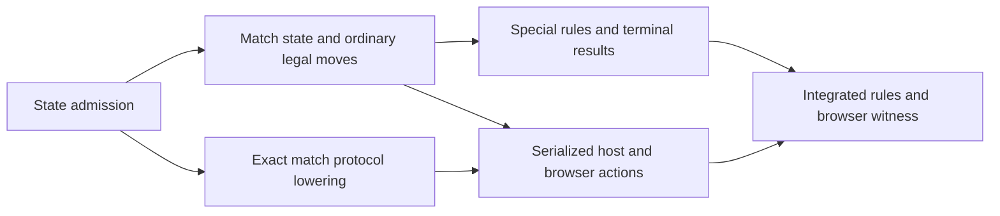

# Milestone 2 delivery: admission first

Status: approved goal; A is ready for bounded dispatch after delivery review. B–E are dependencies, not detailed Hand assignments yet.
Goal: `docs/plans/milestone-2-playable.md`. Repository: `/Users/sterling/Documents/dev/workspaces/personal/zchess`; branch: `codex/faber-rebuild`.

## Approved boundary

Build the shared-screen local legal game described in the goal. The operator approved same-axis en passant, deferring other draw rules, and one memory-only local match. Faber owns complete state/rules; Node retains only an opaque Faber-created capsule between CLI calls. The existing geometry viewer must remain usable. No browser changes, Faber product modules or new dependencies are part of A.

Existing receipts already establish the pinned installation, basic CLI operands/imports, tensor indexing and current geometry. Do not repeat installation, emission/runtime, or original argv probes. The new question is whether the pinned language can round-trip complete match metadata and safely simulate an independent candidate through repeated CLI invocations.

## A — STATE-ADMIT-01: state capsule and candidate isolation

- **outcome:** Observe, or precisely reject, the proposed per-action CLI state mechanism before product implementation depends on it.
- **write_scope:** ignored `.tools/probes/m2-state-admission/faber.toml`, `.tools/probes/m2-state-admission/src/main.fab`, `.tools/probes/m2-state-admission/src/state.fab`, `.tools/probes/m2-state-admission/src/state.proba`, `.tools/probes/m2-state-admission/run.mjs`; tracked receipt only `docs/evidence/m2-state-admission.md`.
- **depends_on:** approved goal and admission delivery review; no other unit.
- **read_scope:** goal, current `src/arena.fab`/`geometry.fab`, accepted evidence, installed Faber explain/reference material. Product files are read-only.
- **non_goals:** legal moves, attack maps, HTTP/server/browser edits, production state protocol implementation, package/dependency/toolchain changes, broad package suites.
- **risk:** medium: string decoding, compound match representation and tensor/metadata aliasing are not yet observed with 1.12.0.
- **integrable:** yes for the evidence document only; ignored probe code cannot be staged as product implementation.

### Probe contract

Use the existing manifest and English CLI pattern. Keep all probe algorithms in Faber; `run.mjs` is a bounded `execFile` witness that forwards opaque capsules and asserts returned evidence, never reconstructs a next state. Use the fixed binary `.tools/faber/1.12.0/bin/faber`, fixed probe root, `shell:false`, timeout 10 seconds per child, stdout ≤1 MiB, serial calls and no network/listener. The runner must stop its children and exit nonzero on failed assertions.

The probe's match value includes a `ti8[8,8,8]` board, 512 moved flags, side, revision, four castling entitlements, optional en-passant skipped target/captured cell/axis, result, and last-move from/to/promotion metadata. Use explicit loops to rebuild a candidate board and moved metadata; mutate that candidate and verify all original fields remain unchanged. A supported concrete representation is the probe's output, not an assumed record syntax.

Use one canonical, versioned ASCII capsule ≤16,384 UTF-8 bytes. Faber alone encodes and decodes it. Require exact field/array lengths, signed piece range −6…6, binary moved values, scalar ranges and consistent absent sentinels. Validate text before any fallible integer conversion; malformed input must return a structured rejection rather than a crash, partial state or fake empty board. This is a transport/representation probe: synthetic dense positions prove capacity, not legal chess positions. Record the exact grammar and bounds chosen in the receipt for later protocol lowering.

CLI operands: `operation`, `capsule` (use `-` for no input). Operations: `seed` emits deterministic state, `roundtrip` decodes/re-encodes it, `candidate` constructs/mutates an independent candidate and reports original-preserved evidence, `advance` makes a **synthetic metadata transition**, and `reject` exercises malformed cases. These are probe operations, not product moves or permission to implement incomplete rules.

Every invocation prints one JSON object with `ok`, an opaque `capsule` on success, and an `observed` evidence object. Faber compares source and decoded fields and reports mismatch counts; a hash alone is insufficient. Errors carry `ok:false` and a stable code. The Node runner parses this envelope, checks the assertions and forwards the returned capsule unchanged to the next process. It may create malformed copies for negative transport tests; it must not calculate a success capsule or next move.

### Required observations / done when

1. **Lossless full state:** seed a deterministic position and varied metadata, encode/decode all 512 cells and flags and every scalar; assert zero mismatches. Separately cover the actual 48-piece initial layout and a dense alternating signed-code sentinel arena to expose indexing/sign/truncation errors. Sentinel values remain representable and deliberately are not treated as legal matches.
2. **Independent mutation:** mutate candidate cells, moved flags and metadata after reconstruction. Show candidate changed at the intended sites and every original field stayed byte-for-byte/value-for-value unchanged. Also show rejected transition retains the original capsule.
3. **Across process boundaries:** Node invokes `seed → roundtrip → candidate → advance → roundtrip` as separate pinned CLI children and forwards each successful capsule verbatim. The synthetic advance changes side/revision and selected metadata in Faber; the next child must observe those exact values and unchanged remaining fields. It is not chess move execution.
4. **Rejected inputs:** include wrong version, missing/extra field, wrong array length, invalid piece/flag/scalar, inconsistent optional metadata, nonnumeric token and capsule exceeding the bound. Exercise noncanonical or truncated input; return rejection without success state. No unchecked conversion may abort these expected negative cases.
5. **Bounds and reproducibility:** record maximum measured capsule bytes, child exit codes, test case count, and the actual independent-child sequence. Place a short command/result receipt plus probe file SHA-256 hashes in `docs/evidence/m2-state-admission.md`; do not commit generated tools or source. Distinguish pass, named-mechanism failure, other diagnostics, and inconclusive tooling limits.

### Narrow commands and proof owner

The admission Hand owns these checks once; they are future commands, **not yet executed planning evidence**. Run serially from the repository root:

```sh
.tools/faber/1.12.0/bin/faber check --locale en .tools/probes/m2-state-admission
.tools/faber/1.12.0/bin/faber test --locale en .tools/probes/m2-state-admission --include state
node .tools/probes/m2-state-admission/run.mjs
```

The check must exit 0. The filtered tests must execute nonzero cases and cover decoding/independence, not merely module loading. The runner must exit 0 only after all required process and rejection assertions; its final summary records cases, maximum capsule bytes and the child sequence. Report diagnostics verbatim, including existing unrelated compiler warnings; never infer a pass from exit 0 with zero cases. Do not run the root Faber or Node suites for this isolated probe.

On a named mechanism failure, stop at A and report the smallest unsupported operation, command and diagnostic. Leave the viewer untouched. On unrelated errors record residuals without repairing other files. On an unavailable observable report `INCONCLUSIVE` and why. No fallback implementation or compiler upgrade is authorized. Mind admits the receipt and routes either downstream lowering or a bounded architecture revision.

## Downstream dependency map



- **B:** Faber initialization/state codec, normal atomic transitions, attack semantics and king-safety filtering. Separate logical changes after the admitted representation is known; preserve geometry queries.
- **C:** same-axis en passant, irreversible file-axis castling, atomic promotion, then complete check/checkmate/stalemate reply detection. Each rule family has matching deterministic tests; no other draws.
- **P/D:** exact request/read-model schemas and Faber command dispatch first; host opaque-state serialization/revision/session handling, then controller/UI integration on disjoint files where safe. Preserve sprites/text, slices and camera; add New game and last move. Never expose partial B as completed legal play.
- **E:** dedicated integration owner runs package/Node hygiene and tests once; separate browser witness owns actual interactions; aggregate audit reviews the landed range. Update README/rules and return a playable local URL for operator review. No CI, push or deployment.

Detailed B–E write scopes and checks must be lowered from A's accepted mechanism receipt before dispatch. The graph permits disjoint host/UI preparation after the exact protocol is fixed; it does not authorize speculative dependent product edits during A.
