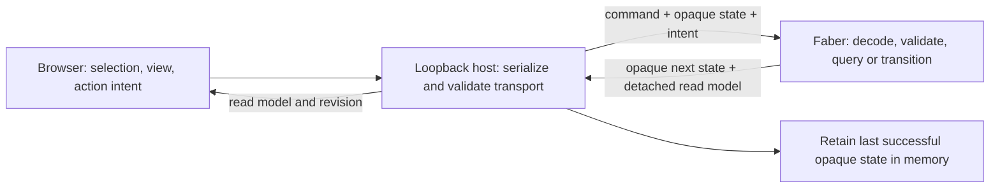

# Milestone 2: playable local zchess

Status: operator-approved milestone implemented and verified for local play. State admission, 88 Faber tests, 51 Node tests, real HTTP/browser witnesses and independent reviews are recorded under `docs/evidence/`. Ready for operator play; standalone formatter limitations remain documented.

## Outcome and boundaries

Two people share one browser screen and play from the 48-piece starting position, with Faber enforcing turns, legal moves, special moves, check, checkmate and stalemate. Keep the existing 3D arena, three orthogonal slice views, PNG/text toggle, selection and camera controls. The geometry sandbox remains separately available for inspecting isolated fixtures; those fixtures cannot replace an active match.

This is a local development milestone, not the public v1 release. AI/search, bit arenas, online play, hosting, phone packaging, undo, move history, save/resume and CI remain outside it. Include a **New game** control and a last-move readout for practical play; neither is a history system. No C restoration, compiler upgrade, dependency addition or generated TypeScript runtime revival.

## Settled rules

The operator's latest decisions resolve the three former geometry questions: retain the current bishop's twelve plane-diagonal rays, exclude combined rank-and-tier pawn advances, and retain the provisional 48-piece arrangement. They supersede the open questions in `zchess-rebuild.md` for this milestone.

- Coordinates remain `(file, rank, tier)` with A–H / 1–8 / S–Z labels and cell ID `file + 8*rank + 64*tier`. Renderer axes do not change the rules or IDs.
- White starts. Rooks use six axis rays; bishops twelve plane diagonals; queens their eighteen-ray union. Knights use the twenty-four signed permutations of `(2,1,0)`; kings have twenty-six adjacent cells before safety filtering. No new piece kinds.
- Pawns advance rank-forward **or** tier-forward separately: white increases either coordinate, black decreases it. An unmoved pawn may double on either axis only when both cells are empty. Any first move consumes both double-step options. Captures use file±1 paired with rank-forward **or** tier-forward; never rank+tier.
- Initial major pieces: white A1S–H1S and black A8Z–H8Z, both R,N,B,Q,K,B,N,R. Pawns: white A1T–H1T and A2T–H2T; black A7Y–H7Y and A8Y–H8Y. Total 48.
- Prior plan records ordinary file-axis castling on the starting rank/tier, immediate en passant after a double on either pawn axis, and promotion to Q/R/B/N only at the opponent's back rank **and** opponent's starting tier. Thus white promotes at rank 8/tier Z, black at rank 1/tier S; arriving at only one boundary does not promote. Ordinary king-safety, checkmate and stalemate semantics apply.

## Approved implementation details

1. **En passant follows the doubled axis.** After a rank double, only a rank-forward pawn capture into the skipped cell qualifies; after a tier double, only a tier-forward capture qualifies. The other coordinate must match that plane. This excludes a perpendicular-axis interception into the skipped cell, which the earlier agreement did not explicitly settle. Store both the skipped target and the pawn's actual destination; remove the pawn from that destination before checking king safety. The right expires after the opponent's next completed move, including a different double step; invalid attempts and selection do not consume it.
2. **Castling keeps its familiar file displacement.** King E→G with rook H→F, or king E→C with rook A→D, on rank 1/tier S for white or rank 8/tier Z for black. Require the original eligible king and rook, neither previously moved, all intervening cells empty, and no check on the king's start, transit or destination. Other tiers provide attack lines, not new castle paths. Moving back, capturing a rook or promoting a replacement never restores rights.
3. **Promotion is one atomic move.** Faber returns the legal Q/R/B/N choices; the browser asks before committing. Missing/invalid choice preserves the whole match and the turn. The final promoted position determines check and end state.
4. **Milestone 2 ends games by checkmate or stalemate only.** Repetition, move-count draws and insufficient-material adjudication need a separate 3D rules decision; do not inherit 2D tables or silently call them implemented. State this limit in the rules notes and UI. No clocks or resignation flow in this milestone.
5. **One shared, memory-only match per local server.** Browser refresh reconnects to that match. New game intentionally replaces it; stopping/restarting the server loses it. Multiple tabs address the same match, with stale actions rejected. This is not save/resume or network multiplayer.

The operator explicitly approved same-axis en passant, deferring other draw rules, and the memory-only shared match. Approval covers the plan above, including New game and the last-move readout. No further rule question blocks admission; unsupported compiler mechanisms still require an evidence-led transport revision.

## Current baseline

`src/arena.fab` constructs the tensor, moved metadata, initial arrangement and JSON fixture snapshots; `src/geometry.fab` computes occupancy-aware previews. Their `.proba` files cover geometry, not legal play. `src/main.fab` accepts fixture/selection string operands. `scripts/serve.mjs` invokes pinned Faber 1.12.0 over a bounded loopback CLI bridge and currently retains no match. `web/controller.mjs` owns selection requests and presentation; `web/main.mjs`, `web/space.mjs` and `web/slices.mjs` display their results. Existing matching Node tests cover these seams.

Reuse those boundaries. Add match logic separately from sandbox fixtures. String CLI operands and JSON output are proved; state decoding, match structures, independent candidate mutation and successive match round trips are not. They are admission work, not assumed language capabilities.

## Architecture and match contract

**Faber owns all match meaning.** A match contains the board tensor, moved metadata, side to move, irreversible castling rights, optional en-passant target/captured-cell/axis, revision, result and last move. Faber initializes and validates it, generates legal move descriptors and emits detached display data. The browser owns presentation and action intent only.

**Persist between CLI calls through an opaque state capsule.** Use bounded, versioned text encoded/decoded only by Faber and retained unchanged in host memory. Each shell-free invocation receives the capsule and a `new`, `read`/selection or `move(from,to,promotion?)` command as string operands. The host never accepts a browser-supplied capsule or edits chess fields. Admit decoding and full-arena argv size first. If that fails, revise this seam before downstream work; no JS rules fallback, compiler upgrade or TypeScript runtime revival.

**Make actions atomic.** Serialize match requests; require expected revision, bounded bodies/queue, time/output limits and local Host/Origin checks. Commit a capsule only after a complete valid Faber success response; failure preserves the last good state. A disconnected browser must not cancel a dispatched mutation; reconnect reads its result. Never auto-retry moves. Reject stale actions and refresh. Faber advances revision across New game; a host process/session token also rejects requests from before server restart. Geometry queries cannot mutate the match.

**Separate attacks from moves.** Pawn attacks use their four capture offsets regardless of occupancy; pushes never attack. King/knight attacks are geometric. Slider attacks include the first occupied endpoint, even friendly, and stop there. Pinned enemy pieces still contribute attacks. Generate candidates, independently reconstruct their tensors/metadata, apply all side effects, then reject those exposing the mover's king. Reject king captures. Do not rely on unproved tensor copy semantics or recursively compute attacks from legal moves. Castling transit checks must not use the rook's final square to hide an attack.

After each complete move, evaluate the opponent's check and legal replies: no replies plus check means checkmate; no replies without check means stalemate. Invalid actions preserve board, rights, en-passant entitlement, turn, revision and result. Promotion choices travel in the final atomic action.

## Delivery milestones and first tasks

These are approved outcome boundaries. `milestone-2-delivery.md` lowers admission first; later delivery passes assign exact scopes using its receipt.

| Milestone | Work and first useful result | Exit condition |
| --- | --- | --- |
| **A. Admit state round trips** | First task: in an isolated ignored probe, prove pinned 1.12.0 can represent match fields, independently rebuild a candidate, encode/decode the bounded capsule and survive successive CLI calls. Include malformed-state rejection. Then define the match protocol and fixture/match separation. | Fresh initial state → move intent → next invocation preserves every field; rejected input preserves prior state; no host rules or compiler/dependency change. Failure routes a transport revision before downstream work. |
| **B. Legal ordinary play** | Add match initialization and atomic normal moves, capture and moved flags. Add attack queries and king-safety filtering before exposing executable moves in the browser. | Both colors alternate; pinned moves, adjacent kings, king captures and exposed checks are rejected. Full 48-piece start works; geometry tests remain intact. |
| **C. Special moves and results** | Add axis-specific en passant, irreversible file-axis castling, atomic promotion, then check/checkmate/stalemate over the complete legal move set. Use legal-position test fixtures distinct from the geometry sandbox. | Both colors and both pawn axes covered; all special-move side effects are included in safety checks and terminal detection. Draw-policy limitation is explicit. |
| **D. Connect the playable browser** | Add serialized match transport and controller actions against the approved protocol; integrate legal selection → destination → optional promotion choice. Display turn, check/result, last move, rejection and pending/error state; include New game and separate Geometry sandbox mode. | Two people can play and capture through either renderer, recover from stale/failing actions, refresh the same live match and restart deliberately. Presentation changes do not change rules or revision. |
| **E. Verify and review** | Run focused rules/protocol/controller checks, package hygiene and one bounded real-browser witness; update README/rules notes and record evidence. | Operator can view and play the current build; evidence states observed passes and unverified limits. Stop for operator review before milestone 3. |

Protocol work can precede browser shell work after A; shared Faber modules and host mutations stay serialized. Do not expose B's normal moves as a complete playable milestone before C's legality and result coverage is integrated.

## Acceptance and verification

- **Faber rules:** both colors, spatial planes, blockers, turns, moved flags, ordinary captures, attacks versus pushes, defended cells, pins/discovered and cross-tier checks, adjacent kings and forbidden king capture. Assert rejected actions preserve every state field and candidate simulation cannot mutate its input.
- **Special rules/results:** castling through/out of/into check and lost rights; en passant on both axes, expiry, wrong-axis rejection and exposed check; promotion at both boundaries, all choices and no partial commit. Checkmate/stalemate fixtures contain both kings and include special-move escapes in the reply search.
- **Boundary/controller:** lossless successive CLI calls; corrupt/version-mismatched capsules; malformed output, limits and timeout; competing/stale actions, disconnect after dispatch and refresh. Verify untouched capsule transport, no optimistic browser board changes, promotion cancellation, error recovery and geometry/match separation.
- **Integrated checks:** pinned package check and Faber test runner, existing Node tests plus new match tests, and changed-file hygiene. Measure executed tests. Retain the documented isolated formatter SEM010 limitation rather than upgrading to conceal it; CI remains milestone 3.
- **Separate browser witness:** record browser, commit and live server. Observe two-color turns/captures, rejection, check/result display, promotion, deliberate New game, geometry separation and moves through both renderers with sprite/text and camera preserved. Rare-rule proof primarily comes from deterministic Faber fixtures. Do not claim a complete game or unavailable browser checks were witnessed.

## Approval and readiness

**Goal-check verdict: READY for gated admission delivery.** The operator approved the outstanding rules and ephemeral match posture. State-capsule decoding and candidate independence remain unproved; A is the explicit investigation boundary, not permission to start its dependents. After its accepted receipt, lower the supported protocol and remaining implementation units. Return to the operator only for a material rule, ownership, runtime or persistence change. No push, deploy or milestone 3 work is authorized.

References: `docs/plans/zchess-rebuild.md`; `docs/plans/milestone-1-delivery.md`; `docs/evidence/m1-validation.md`; `docs/evidence/sprite-toggle.md`; the source/test paths in the baseline section. The vault's `Objects/People/Aiden Benedict Zepp.md` describes zchess as an experimental systems project; it supplies context, not current rules.
