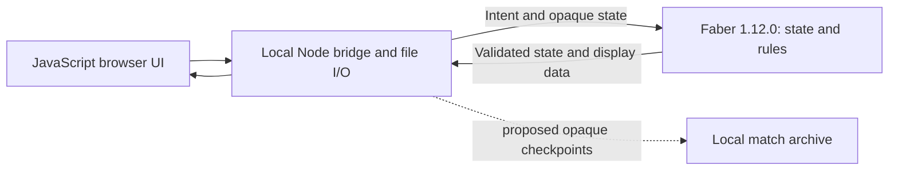

# Proposed local v1 readiness

Status: planning draft for operator approval. No implementation, installation, publishing or persistence changes are authorized by this document.

## Proposed v1 definition

An **experimental local shared-screen game**, initially supported on macOS Apple Silicon: two people can install it from a clean checkout, understand the arena, play a complete game, recover their current match and inspect the agreed rules. Keep the current 48-piece setup and movement choices; repetition, move-count and insufficient-material draws remain explicitly deferred. They are not new v1 gates.

**The frontend is currently JavaScript.** Faber owns arena state, rules and legal transitions; JavaScript implements three.js/Canvas2D rendering and controls, and Node runs the local bridge. This proposal retains that ownership. It does not promise an all-Faber frontend, standalone browser-only executable, Rust/Go builds, public hosting, online multiplayer, AI, bit arenas or mobile support. If an all-Faber UI is required for v1, decide that before lowering this plan; current compiler/runtime evidence does not establish that route.

## Observed baseline

- Current source implements alternating legal play, king safety, castling, same-axis en passant, atomic promotion and checkmate/stalemate. New game, a last-move readout, the rules guide, sprites/text and all views already exist; do not reimplement them.
- `docs/evidence/m2-validation.md` records **88 Faber and 51 Node cases**, actual HTTP turns/captures and stale/failure recovery. These are accepted historical results, not new runs in this planning pass.
- `m2-playable-browser.md` records four actual moves/captures, refresh, New game and view controls. Promotion/check/results used explicitly separate Faber-backed UI fixtures. **No independent complete game from the initial position to an ending has been witnessed.** Dense initial sprites overlap at some camera angles; visibility remains a user acceptance concern.
- `scripts/serve.mjs` holds one opaque capsule/revision in memory. Refresh preserves it; server restart loses it. No durable saves, history or undo exist. Old-session/revision requests are rejected; disconnected dispatched mutations finish.
- `package.json` and `faber.toml` both say **0.1.0**, not 1.0.0. The npm package is private. README requires manual pinned Faber setup and Node/npm; only the existing macOS arm64 installation and local browser workflow are evidenced. No `.github/` CI configuration exists.
- The 1.12.0 package check/test/runtime pass in the recorded gate, while standalone formatting refuses imports with **SEM010/SEM002**. `m2-format-followup.md` removed the separate `match.fab` formatting debt and passed its ten targeted tests. Do not present the remaining formatter refusals as a pass.
- MIT covers newly authored code/docs. Existing twelve PNGs are explicitly excluded; Wikimedia origin is user-reported, with exact source/author/license still unverified. Current dependencies and tools keep their own licenses.

## Proposed minimum gaps

| Milestone | Required result before calling this v1 |
| --- | --- |
| **1. Readable play and full-game acceptance** | Review initial camera/sprite overlap and compare a small number of practical views/focus controls. Make selection, turn, target depth and errors understandable without reading IDs. Conduct an independent two-player game from the actual initial setup to an ending, recording usability/rule defects and repairing material failures. Fixture demos supplement this, not replace it. |
| **2. Small recovery workflow** | If approved, add the history/undo/autosave semantics below, with Faber-authoritative restoration, restart recovery and atomic failure tests. Current New game needs only the persistence-aware confirmation/backup change. |
| **3. Reproducible checkout and checks** | One guided documented setup path for the explicitly supported platform, exact compiler tag/asset/checksum and bundled share directory, locked dependencies and a clean-checkout witness. Add pinned CI for package check/rules/Node boundary tests and visible formatter disposition. Confirm runner/platform availability before choosing workflow details; do not imply untested platform support. |
| **4. Release candidate** | Resolve sprite provenance or approve clearly licensed replacements; update rule/known-limit documentation and validation claims. Align both version manifests and lock metadata to the approved release number only when gates pass. Review source contents and notices, then seek explicit approval for the exact tag/push/release target. |

### Proposed minimum history, undo and persistence

**History/undo:** show completed moves in order, with side, coordinates and promotion from Faber-produced display data. Undo one completed move per click, repeatable back to this game's initial position; no redo or variations. Faber validates the previous opaque state, restores all board/turn/moved/castling/en-passant/result fields, recomputes status and assigns **current revision+1**, never the historical revision. Undo after a terminal result reopens the prior state. Cancelled promotion and rejected actions create no entry. A move after undo starts a new continuation; discarded future moves are not retained as hidden redo. All tabs share this timeline and must pass current session/revision checks.

**Autosave/resume:** propose one checkout-local ignored archive under `.local/zchess/`, not browser localStorage or a global account. Node stores opaque Faber-created checkpoints and Faber-produced display receipts; it neither edits chess fields nor invents inverse moves. Only the current/previous checkpoint needed by an action crosses the CLI boundary, not an ever-growing archive argument. On undo/resume, Faber checks the selected checkpoint before it becomes authoritative. New restore operations and bounded archive validation require targeted admission/tests; they are not claimed current capabilities.

Persist each accepted action/undo by atomic file replacement **before acknowledging or committing it in memory**. A write failure leaves the old match authoritative and returns an actionable error; no silent unsaved success. After a crash between durable replacement and response, restart loads the stored state under a fresh process session, so the browser must read rather than retry. Test process-restart/crash recovery; do not claim power-loss guarantees without separate evidence.

**Retention/reset proposals:** retain the current game's timeline plus one previous-game backup. New game confirms replacement when play exists, starts a clean timeline, and preserves that game's archive as the single backup; a later confirmed New game replaces the older backup. Corrupt/incompatible files stay untouched and produce a clear recovery error, never an implicit reset. Version the archive separately from app version/capsule version. No arbitrary file import, automatic migrations, cloud sync or unlimited game library in minimum v1; these are later options. These retention and deletion semantics require approval, rather than extending milestone 2's memory-only agreement silently.

## Acceptance and verification

Use normal Faber/Node gates after implementation, with nonzero executed cases and real CLI/HTTP restoration evidence. Cover undo through ordinary capture, both en-passant axes, both castles, promotion and terminal states; restored rights/entitlements must be exact. Cover disk failure, corrupt/version-mismatched archive, restart, concurrent stale tabs and New game backup replacement. Recovery tests must prove Faber validates/restores state, not merely that Node reads JSON.

A fresh macOS arm64 checkout must reach the ready local URL using only documented steps and verified pins. CI must reproduce semantic/rule/boundary checks; formatter refusals remain separately visible under an **explicit approved compiler-limit waiver**, with new format dirt/errors surfaced. Do not apply the known runtime-breaking cast workaround or upgrade implicitly. Browser evidence must identify real gameplay versus UI fixtures, actual build/commit, readable default view and the independent full-game result.

Before public redistribution, each included sprite needs a traceable source and applicable license/notice record, or an approved replacement. Text fallback alone does not settle rights to PNGs still included in an artifact. Preserve the existing MIT scope and third-party notices. No compiler/dependency redistribution claim is assumed; avoid bundling tools unless its terms have been checked.

## First tasks after approval

1. Settle the five choices below and record the accepted v1 boundary; then lower independent visibility/asset research and recovery admission work.
2. Admit Faber checked restoration and disk-commit ordering with focused probes before adding persistence to the live server. Preserve the current memory-only viewer during this work.
3. Lower checkout/CI work for a verified runner and supported platform; schedule the independent playtest once its visibility fixes are available. Release preparation follows accepted evidence, not a version bump first.

Optional/later: redo, arbitrary save import/export, multiple archived games, alternate setups/rule changes, extra draw rules, more platforms, UI rewrite, standalone browser packaging and all online/AI/mobile work.

## Approval questions and readiness

1. Is a local experimental v1 with the **current Faber rules + JavaScript UI/Node shell** acceptable, or is an all-Faber frontend a prerequisite?
2. Include the proposed **history, repeatable one-move undo and autosave**, with one previous-game backup, or keep v1 memory-only?
3. Support **macOS Apple Silicon only** initially, documenting other platforms as unverified?
4. First try to establish the existing sprites' provenance, or prefer replacing them with a clearly licensed set?
5. Accept the documented **1.12.0 formatter waiver** while semantic/runtime gates pass, or require an upstream formatter fix before v1?

**Goal-check verdict: NOT READY for implementation delivery.** This is ready for operator review, with material persistence/runtime/release-boundary choices above. After those answers and plan approval, lower concrete work; no new installation or product change is authorized here. Stop for any additional material rule, runtime, data-retention or licensing decision. A later release/tag/push/deploy requires explicit target approval.

References: current `README.md`, `LICENSE`, `docs/rules.md`, `package.json`, `faber.toml`, `scripts/serve.mjs`, `src/match.fab`, `src/protocol.fab`; `docs/plans/milestone-2-playable.md`; `docs/evidence/m2-validation.md`, `m2-format-followup.md`, `m2-playable-browser.md`. This pass used local evidence only; no external platform, asset-license or new Faber-backend capability was verified.
