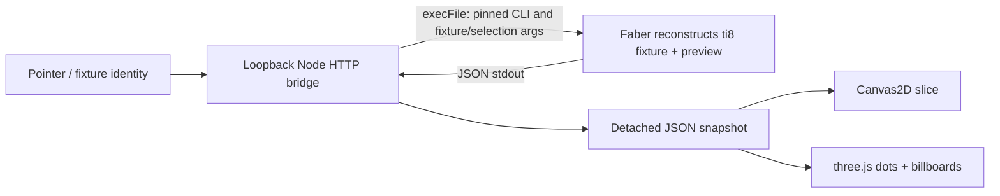

# zchess rebuild

Status: milestone 1 implemented locally; combined validation, browser witness, and aggregate acceptance pending.
Owner: Mind. Planning records: Vivi tasks `04d56b20`, revision `82446a20`.
Repository: `/Users/sterling/Documents/dev/workspaces/personal/zchess`.

## Summary

Replace the disposable C prototype with a browser-first Faber implementation of 8×8×8 chess. The first milestone is an arena viewer for comparing movement geometry in manipulable 3D and orthogonal 2D slices. It is not a playable chess release. The operator approved this direction and installation of Faber 1.12.0; this document records that approval without extending it to hosting or later rules decisions.

## Problem and goals

The extra dimension makes otherwise familiar moves hard to reason about. The existing prototype shows pieces and candidate cells but cannot reliably demonstrate the proposed movement rules. A useful first result lets the operator inspect the provisional initial arrangement and isolated piece positions, select any cell, and compare the same candidate destinations between views.

All authored arena state, fixture construction, piece identity, moved metadata and movement calculations belong to English Faber. Each request reconstructs a fixture and computes a preview; there is no persistent match state. The browser retains only presentation/request identity (fixture and selected-cell identifiers, camera and slice), while a local Node HTTP bridge invokes pinned Faber and transports JSON. Use a simple `ti8[8,8,8]` piece tensor and separate metadata; do not introduce bitboards or search-oriented architecture.

## Non-goals for milestone 1

- Move execution, turn enforcement, king safety, check/checkmate/stalemate.
- Castling, en passant, promotion execution, undo, move history, save/resume.
- AI, search, multiplayer networking, agent controls, phone packaging, public hosting, deployment. Loopback HTTP is temporary local viewer transport only.
- Settling provisional bishop geometry, initial setup, or the undecided combined pawn advance.
- Visual polish beyond readable geometry and usable controls; exhaustive browser automation.

## Ground truth researched

Observed on 2026-10-16 America/Chicago (2026-10-17 UTC):

- Base `aced8a5` on `master`; origin `git@github.com:aidenzepp/zchess.git`; clean tracked working tree before planning. Planning branch: `codex/faber-rebuild`.
- `src/engine.h` defines 512 cells, six piece kinds, two colors and per-token moved metadata. `src/engine.c` initializes 48 pieces. `src/zchess.c` is a raylib viewer; the Makefile builds C.
- The old bishop has only four same-tier rays, the knight only twelve offsets, pawn previews are absent, and king safety is not enforced. The C implementation is historical evidence, not a rule oracle.
- The tracked product inventory is `.gitignore`, `Makefile`, three C/header files, and twelve PNGs. No tracked README, license, tests, or CI exist.
- The vault search found no dedicated zchess/Faber note. `Objects/People/Aiden Benedict Zepp.md`, “Public engineering work,” describes zchess as an experimental systems project. Current operator instructions and source settle this rebuild's scope.
- Current agent canon documents packages, English source, shaped tensors and check/format/test commands. Current TypeScript docs show emitted code using `@faber/runtime` tensor support. This proves a published contract, not execution with the pinned binary.
- Current compiling documentation calls TypeScript a probe/emission path, not a complete package product. Triga's page describes browser products and WebGPU demo hosts. These claims are inconsistent enough to require an admission proof.
- Tela documents early DOM/Canvas2D contracts, incomplete package assembly, and no in-tree real-browser run. Triga is not a three.js binding. Its host is additional machinery unnecessary for this first viewer.
- The requested public `faberlang/examples` repository and the previously referenced example commit `5f726f1f46cbd3430c7e6f26905ab2103697a860` returned HTTP 404 during this pass. Historical example workarounds were not revalidated or copied.
- ENV-01 receipt `431c1006` proves exact Faber 1.12.0 installation, published checksum verification, `ti8[8,8,8]` construction/indexing, ranges and one tensor test. ENV-02 receipt `27e9f381` proves Faber CLI stdout `[0, 4]` parsed by Node. It also records the blocked generated-TS route: missing `@faber/runtime` and non-exported emitted function. Mind accepted the CLI route; do not rerun these probes.
- Revision input/module probe under ignored `.tools/probes/planner-abi/` proves a manifest package with `import from "./echo" echo`, `@ public` sibling function, `@ cli`, two string operands and string-to-i32 conversion. `faber check --locale en` exits 0 (WARN003); `faber run --locale en ... -- initial 227` prints `initial` and `227`; selection `-1` also passes. Package-level `locale` and i32 CLI operand declarations were rejected; use `--locale en` and string operands with conversion. The full HTTP/viewer and product JSON serializer are not yet implemented or proved.

## Constraints and rule baseline

Coordinates are zero-based internally `(file, rank, tier)` in `[0,7]³`, labeled A–H / 1–8 / S–Z. White is the lower-tier side and starts first in the future game. The following movement is the milestone 1 preview baseline:

| Piece | Preview geometry |
| --- | --- |
| Rook | Six signed axis rays. |
| Bishop | Twelve signed plane-diagonal rays: exactly two nonzero components of equal magnitude. No body diagonals. Provisional pending visual review. |
| Queen | Union of rook and bishop rays, eighteen directions. |
| Knight | All twenty-four distinct signed permutations of `(2,1,0)`; jumps over occupancy. |
| King | Twenty-six adjacent cells, excluding own occupancy; no attack/check filtering yet. |
| Pawn | White rank+ or tier+; black rank− or tier−, separately. One cell or two on either axis while unmoved, with clear intermediate and destination. A first move will consume both double options. Capture only file±1 paired with rank-forward OR tier-forward, on enemy occupancy. No rank+tier capture. Combined noncapturing rank+tier remains undecided and is excluded. |

Sliding previews stop at the first occupied cell, include enemy occupancy, exclude friendly occupancy, and never pass beyond either. All previews stay in bounds, exclude origin, and contain no duplicates. They are geometry with occupancy, not full legal moves. There is no move application in milestone 1; moved metadata is exercised through fixtures.

Provisional initial setup reproduces the C table: white back row A1S–H1S is R,N,B,Q,K,B,N,R; white pawns A1T–H1T and A2T–H2T; black pawns A7Y–H7Y and A8Y–H8Y; black back row A8Z–H8Z is R,N,B,Q,K,B,N,R. All start unmoved.

Later approved rules remain recorded without implementing them: ordinary file-axis castling at the starting rank/tier; both-axis en passant immediately after a double step; promotion only at the opponent's back rank AND opponent's starting tier, with Q/R/B/N choice. Full legality applies ordinary check/checkmate/stalemate semantics. A changed rule requires operator review, not an implementation guess.

## Architecture direction

Renderer: native browser Canvas2D for 2D slices and a thin three.js shell for sparse 3D dots, billboard piece labels, pointer and keyboard orbit/pan/zoom/reset, and picking. Use text-drawn billboard textures initially, avoiding dependency on the old PNG provenance. Retain PNG files as optional existing assets; do not silently claim the new MIT license covers them. Plain browser ESM and Node suffice; no Vite, TypeScript, Triga or Tela dependency is required.

The selected boundary is the accepted Faber CLI-to-JSON-to-Node proof. Invoke the pinned executable directly with an argument array; the local server only validates transport shape, runs a stateless Faber fixture query, validates the response and serves local assets. It owns no board, movement algorithm or game action. Bind loopback only. HTTP and browser behavior must still be proved during transport delivery and the final viewer witness. Do not revive the blocked TS runtime path, alter generated output, change Faber 1.12.0, or replace the tensor silently.

## First useful milestone and future sequence

1. **Arena geometry viewer:** actual Faber arena/preview fixture queries through the local CLI bridge, shared selection across 3D and three slice planes, local launch and geometry disclaimer. Lowered separately in `milestone-1-delivery.md`.
2. **Legal local game:** settle visual rule questions, then add alternating play, king safety, special moves, promotion, end states and rule tests.
3. **Complete v1 workflow:** undo/restart/history/save/resume, rules guide, and pinned CI for format/check/rules/browser build. No delivery lowering or implementation authorization for these later milestones is implied here.

## Acceptance criteria

1. Faber 1.12.0 is explicitly invoked; the English package checks. Every snapshot and preview is recomputed from current Faber source, with no parallel authored rules implementation or persistent host board.
2. Initial setup and isolated fixtures for all six pieces, both pawn colors, moved pawns, and occupancy blockers are selectable. Every fixture resets selection and stale highlights.
3. The operator can orbit/pan/zoom/reset 3D by pointer and keyboard, pick pieces or empty dots, and inspect clearly labeled coordinates and previews.
4. The operator can choose file/rank with fixed tier, file/tier with fixed rank, or rank/tier with fixed file, with an explicit 0–7/label selector for the omitted coordinate.
5. The same selected cell and Faber destination set drive both views. Off-slice selection/destinations are clearly indicated; changing view/camera does not alter arena state or previews.
6. “Geometry preview — king safety and special moves are not implemented” is visible. No misleading playable-game controls are shown.
7. A documented local command checks current Faber and launches on loopback, gives a ready URL, reports startup/query failures, and stops cleanly. No browser build step, remote service or deploy is required.
8. C and Makefile are removed at the milestone integration boundary, preserved in git history only. New authored code is MIT; generated files/tools/dependencies remain out of source commits.
9. A separate viewer acceptance receipt records actual browser, commit, current build and bounded manual checks; unavailable or failed checks remain explicit.

## Validation and release posture

This is local development delivery. Accepted ENV receipts establish only their narrow runtime boundary. The delivery document assigns targeted rule checks, bridge transport checks, package hygiene and a separate manual viewer witness to their owners. Future product commands remain unexecuted until those receipts exist. A passing CLI query alone cannot admit the HTTP/browser workflow or declare the milestone complete.

## Exit strategy and stop conditions

Keep unfinished changes on the local rebuild branch; no push, merge, tag, release or deploy is authorized by this planner task. Leave master history recoverable. A failed product Faber query blocks its exact downstream boundary; report it without upgrades or a JavaScript rules fallback. Preserve installer/other-agent dirt. Stop for any new material rule choice, persistent match/server architecture, renderer dependency beyond the permitted presentation boundary, or unsupported Faber mechanism requiring architecture change.

## Open questions

No additional product decision blocks the arena, transport or rendering units after delivery audit. Full snapshot serialization, HTTP transport and real browser use remain product checks. The local argv and sibling-import mechanisms now have narrow runtime evidence. Bishop/body-diagonal, initial-layout and combined-pawn questions are deliberately deferred to operator inspection of the viewer.

## Reference list

- Local source: `src/engine.h`, `src/engine.c`, `src/zchess.c`, `Makefile` at base `aced8a5` (use git history after retirement).
- [Agent canon](https://faberlang.dev/agents/index.md), [smallest package](https://faberlang.dev/agents/program.md), [packages](https://faberlang.dev/agents/packages.md), [modules](https://faberlang.dev/agents/modules.md), [tensor reference](https://faberlang.dev/agents/reference/tensor.md).
- [TypeScript emission](https://faberlang.dev/en-US/targets/ts.html), [compiling contracts](https://faberlang.dev/en-US/toolchain/compiling.html), [target matrix](https://faberlang.dev/en-US/toolchain/target-matrix.html).
- [Triga](https://faberlang.dev/en-US/libraries/triga.html), [Tela / Canvas2D status](https://faberlang.dev/en-US/libraries/tela.html).
- [Requested examples repository](https://github.com/faberlang/examples): unavailable as a public source in this pass; example names browser-app, canvas2d-interactive, web-canvas2d-smoke are discovery leads, not executed evidence.

## Goal check

Evaluator: planner, preimplementation full-pipeline; consumer: delivery.
Verdict: **READY** for gated delivery.

The selected local CLI boundary has accepted narrow evidence, and argv/module details now have a scoped probe. Units define exact JSON, geometry, ownership and operator acceptance. READY does not assert HTTP/browser success or approve shipping. Start product work after independent delivery audit; close M1 only after integrated checks and the separate viewer witness.
