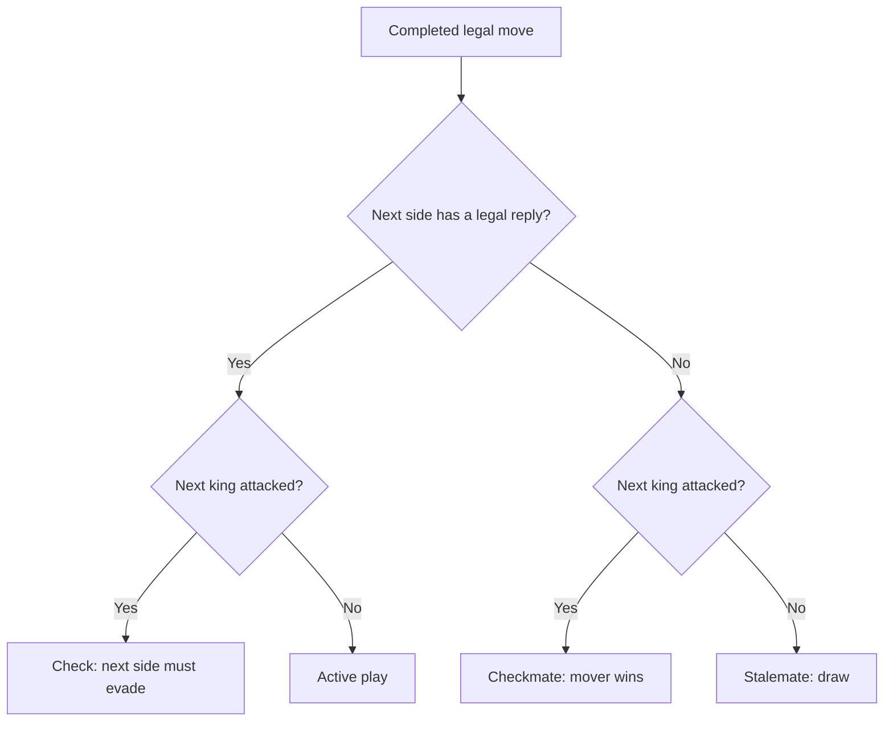

# Zchess rulebook

Zchess extends the familiar chess pieces into an 8×8×8 arena. Two players use 48 pieces, with White moving first. These are the agreed rules for the current local playable version. The setup and movement choices remain open to future design revisions.

## Contents

- [Arena, coordinates and notation](#arena-coordinates-and-notation)
- [Starting position](#starting-position)
- [What makes a move legal](#what-makes-a-move-legal)
- [Rook, bishop and queen](#rook-bishop-and-queen)
- [Knight and king](#knight-and-king)
- [Pawns](#pawns)
- [En passant](#en-passant)
- [Castling](#castling)
- [Promotion](#promotion)
- [Attacks and king safety](#attacks-and-king-safety)
- [Check, checkmate and stalemate](#check-checkmate-and-stalemate)
- [Browser controls and match lifecycle](#browser-controls-and-match-lifecycle)
- [Edge-case FAQ](#edge-case-faq)
- [Implementation references](#implementation-references)

## Arena, coordinates and notation

The **arena** contains 512 cells. Each cell has a file, rank and tier, in that order.

| Coordinate | Labels in increasing order | Meaning |
| --- | --- | --- |
| File | A B C D E F G H | Position across a plane |
| Rank | 1 2 3 4 5 6 7 8 | Position along the other direction of that plane |
| Tier | S T U V W X Y Z | Which of the eight parallel planes contains the cell |

`D4V` means file D, rank 4, tier V. Changing one coordinate leaves the other two unchanged. `D4V → D4W` changes only tier. `D4V → D5V` changes only rank.

```text
File/rank planes, one per tier:

S  →  T  →  U  →  V  →  W  →  X  →  Y  →  Z
0     1     2     3     4     5     6     7   (internal tier indices)

Each plane has files A–H and ranks 1–8.
```

An **axis move** changes exactly one coordinate. A **plane diagonal** changes exactly two coordinates by the same distance. A **body diagonal** changes all three by the same distance. A **ray** repeats one direction for one or more cells.

Examples use `Δ(file, rank, tier)` for coordinate changes. `D4V → F6V` has delta `(+2,+2,0)`. A minus sign means a decrease. There is no wrapping at an arena edge.

Arrows in this rulebook describe examples. They are not a formal 3D PGN notation. Piece letters are K king, Q queen, R rook, B bishop, N knight and P pawn. Diagram prefixes `w` and `b` mean White and Black. A dot means an empty cell.

The renderer currently maps file to X, tier to Y and rank to Z. Rotating the camera or changing the displayed axes does not change the rules. Internally, zero-based coordinates identify a cell as `file + 8*rank + 64*tier`.

## Starting position

Each player has one king, one queen, two rooks, two bishops, two knights and sixteen pawns. That is 24 pieces per side, 48 in total.

| Side | Back row | Pawn rows | Pawn forward directions |
| --- | --- | --- | --- |
| White | A1S–H1S | A1T–H1T and A2T–H2T | Increasing rank or tier |
| Black | A8Z–H8Z | A7Y–H7Y and A8Y–H8Y | Decreasing rank or tier |

These are all occupied starting cells. The four planes below show the complete arrangement. Every cell on tiers U, V, W and X is empty.

```text
Tier S                         Tier T
    A  B  C  D  E  F  G  H         A  B  C  D  E  F  G  H
8   .  .  .  .  .  .  .  .     8   .  .  .  .  .  .  .  .
7   .  .  .  .  .  .  .  .     7   .  .  .  .  .  .  .  .
6   .  .  .  .  .  .  .  .     6   .  .  .  .  .  .  .  .
5   .  .  .  .  .  .  .  .     5   .  .  .  .  .  .  .  .
4   .  .  .  .  .  .  .  .     4   .  .  .  .  .  .  .  .
3   .  .  .  .  .  .  .  .     3   .  .  .  .  .  .  .  .
2   .  .  .  .  .  .  .  .     2  wP wP wP wP wP wP wP wP
1  wR wN wB wQ wK wB wN wR     1  wP wP wP wP wP wP wP wP

Tier Y                         Tier Z
    A  B  C  D  E  F  G  H         A  B  C  D  E  F  G  H
8  bP bP bP bP bP bP bP bP     8  bR bN bB bQ bK bB bN bR
7  bP bP bP bP bP bP bP bP     7   .  .  .  .  .  .  .  .
6   .  .  .  .  .  .  .  .     6   .  .  .  .  .  .  .  .
5   .  .  .  .  .  .  .  .     5   .  .  .  .  .  .  .  .
4   .  .  .  .  .  .  .  .     4   .  .  .  .  .  .  .  .
3   .  .  .  .  .  .  .  .     3   .  .  .  .  .  .  .  .
2   .  .  .  .  .  .  .  .     2   .  .  .  .  .  .  .  .
1   .  .  .  .  .  .  .  .     1   .  .  .  .  .  .  .  .
```

White takes the first turn. Players then alternate one completed legal move. Castling moves two pieces as one turn. Promotion is part of the pawn's move, not a second turn.

## What makes a move legal

Movement geometry describes a piece's possible shape of movement. A complete legal move must also satisfy occupancy, turn, special-move rights and king safety.

- The moving piece belongs to the side whose turn it is.
- The destination is inside the arena and does not contain a friendly piece.
- Sliding paths are clear. Only knights jump over occupied cells.
- An ordinary capture removes the enemy piece on the destination. En passant has a separate captured cell.
- The move leaves the moving side's king unattacked.
- Kings are never captured. Checkmate ends the game before a king capture.

Unless a section gives a complete mini-position, its examples illustrate geometry only. An allowed example assumes the correct turn, a clear required path, suitable destination occupancy, both kings present and a safe moving king. It does not assert that the move works from the starting position. Rejected geometry remains rejected even with an empty path.

## Rook, bishop and queen

These pieces slide. They stop at the first occupied cell on a ray. They may capture an enemy on that cell, but cannot pass through it or land on a friendly piece.

The direction counts below describe possible rays before arena edges and blockers. They are not counts of available destination cells.

| Piece | Directions | Allowed coordinate changes |
| --- | --- | --- |
| Rook | 6 rays | One nonzero coordinate |
| Bishop | 12 rays | Two nonzero coordinates of equal magnitude |
| Queen | 18 rays | The union of rook and bishop rays |

### Rook

A rook moves any positive distance along file, rank or tier. The six directions are the two signs of each axis.

| Example from D4V | Delta | Geometry |
| --- | --- | --- |
| D4V → G4V | `(+3,0,0)` | Allowed file ray |
| D4V → D1V | `(0,-3,0)` | Allowed rank ray |
| D4V → D4Y | `(0,0,+3)` | Allowed tier ray |
| D4V → E5V | `(+1,+1,0)` | Rejected: two coordinates change |

For `D4V → D4Y`, cells D4W and D4X must be empty. An enemy on D4W may be captured there and blocks D4X and D4Y.

### Bishop

A bishop moves along diagonals within any of the three coordinate planes. For each plane there are four signed diagonal directions, giving twelve rays.

```text
From D4V, the positive diagonal in each plane begins:

file + rank:  D4V → E5V → F6V → G7V → H8V
file + tier:  D4V → E4W → F4X → G4Y → H4Z
rank + tier:  D4V → D5W → D6X → D7Y → D8Z
```

| Example from D4V | Delta | Geometry |
| --- | --- | --- |
| D4V → B6V | `(-2,+2,0)` | Allowed file/rank diagonal |
| D4V → F4X | `(+2,0,+2)` | Allowed file/tier diagonal |
| D4V → D2X | `(0,-2,+2)` | Allowed rank/tier diagonal |
| D4V → D4W | `(0,0,+1)` | Rejected: an axis ray |
| D4V → E5W | `(+1,+1,+1)` | Rejected: a body diagonal |
| D4V → F5V | `(+2,+1,0)` | Rejected: unequal distances |

On a checker coloring defined by the parity of `file + rank + tier`, every bishop move preserves color. The converse is false. For example, D4V and F4V share checker color, but their connecting line is a rook axis. Cell color is a consequence of bishop geometry, not a sufficient movement test. Piece color, White or Black, is a separate concept.

### Queen

A queen combines the rook's six rays and bishop's twelve rays. It does not gain body diagonals.

`D4V → D4Z`, delta `(0,0,+4)`, and `D4V → G7V`, delta `(+3,+3,0)`, have queen geometry. `D4V → E5W`, delta `(+1,+1,+1)`, does not. `D4V → G6V`, delta `(+3,+2,0)`, also fails.

This makes the queen's nearby movement different from the king's. A king can step from D4V to E5W. A queen cannot make that same step.

## Knight and king

### Knight

A knight changes one coordinate by two cells and another by one, leaving the third unchanged. All signs and axis assignments are allowed. There are `3 × 2 × 4 = 24` offsets before edge and occupancy restrictions.

| Example from D4V | Delta | Geometry |
| --- | --- | --- |
| D4V → F5V | `(+2,+1,0)` | Allowed |
| D4V → E4X | `(+1,0,+2)` | Allowed |
| D4V → D2W | `(0,-2,+1)` | Allowed |
| D4V → E5W | `(+1,+1,+1)` | Rejected: three one-cell changes |
| D4V → F6V | `(+2,+2,0)` | Rejected: two two-cell changes |

Intervening pieces do not block a knight. A friendly destination still blocks landing. Moving a pinned knight can still be illegal because the move exposes its king.

### King

A king changes each coordinate by at most one cell, and must change at least one. There are `3³ − 1 = 26` adjacent offsets before boundaries and safety restrictions. Axis steps, plane diagonals and body diagonals all count.

`D4V → D4W` and `D4V → E5W` have king geometry. `D4V → D4X`, delta `(0,0,+2)`, does not. A king may capture an enemy piece only when the resulting cell is safe.

Kings cannot be adjacent along any of these 26 offsets. That includes adjacency through a cube corner, such as White on D4V and Black on E5W.

## Pawns

Pawns have two forward axes. They do not move backward. White increases rank or tier. Black decreases rank or tier. File changes occur only in captures.

| Action | White delta | Black delta |
| --- | --- | --- |
| Rank advance | `(0,+1,0)` | `(0,-1,0)` |
| Tier advance | `(0,0,+1)` | `(0,0,-1)` |
| First rank double | `(0,+2,0)` | `(0,-2,0)` |
| First tier double | `(0,0,+2)` | `(0,0,-2)` |
| Rank capture | `(±1,+1,0)` | `(±1,-1,0)` |
| Tier capture | `(±1,0,+1)` | `(±1,0,-1)` |

### Advances and the first move

An ordinary advance lands on an empty cell. A double advance requires an unmoved pawn and an empty intermediate cell and destination. Being on a particular starting rank is not an additional requirement.

A pawn's first completed move consumes both double options. After a first rank move, it cannot later double along tier. A first capture also consumes both options. An invalid attempt or a canceled promotion does not count as a completed move.

For an unmoved White pawn on D4V, the possible advance shapes are D5V, D6V, D4W and D4X. The rank double passes through D5V. The tier double passes through D4W. The pawn never moves D4V → D5W in one turn.

For an unmoved Black pawn on D5W, the corresponding advances are D4W, D3W, D5V and D5U. A piece on D4W prevents the rank single and double, but does not by itself block the tier advance.

### Captures

A pawn has four capture offsets before boundaries. A White pawn on D4V attacks C5V, E5V, C4W and E4W. A Black pawn on D5W attacks C4W, E4W, C5V and E5V.

```text
White pawn on D4V:

rank capture plane, tier V       tier capture plane, rank 4
     C   D   E                       C   D   E
5    x   .   x                  W    x   .   x
4    .  wP   .                  V    .  wP   .

x = attacked cell; an ordinary capture needs an enemy there.
```

A pawn does not capture on its straight advance cells. It does not capture with delta `(0,+1,+1)` or `(+1,+1,+1)` for White, or their Black equivalents. En passant is the sole empty-destination capture described below.

### Boundaries

Reaching a boundary on one forward axis does not stop movement on the other. White on D8V may still advance to D8W. White on D4Z may still advance to D5Z. Black on D1V may advance to D1U, and Black on D4S may advance to D3S. These cells are not promotion cells because only one required boundary has been reached.

## En passant

En passant captures a pawn immediately after its two-cell advance. The capturing pawn moves onto the skipped cell and removes the advanced pawn from its actual destination. The skipped cell must be empty.

The capture must use the same axis as the double advance. A rank double permits a rank-forward capture. A tier double permits a tier-forward capture. The capturing pawn still changes file by exactly one.

### Both axes and both colors

Each row is a separate conditional example. The double-moving pawn is unmoved, its two advance cells are clear, and all moves must preserve king safety. The capturing pawn is already on the listed cell when the double occurs.

| Double advance | Skipped cell | Capturing reply | Pawn removed from |
| --- | --- | --- | --- |
| Black D5V → D3V | D4V | White C3V → D4V | D3V |
| White D3V → D5V | D4V | Black C5V → D4V | D5V |
| Black D4W → D4U | D4V | White C4U → D4V | D4U |
| White D4U → D4W | D4V | Black C4W → D4V | D4W |

The other file flank is also possible. In the first row, White on E3V could capture to D4V instead.

```text
First row, tier V:

Before Black's double       After double          After en passant
    C   D                       C   D                 C   D
5   .  bP                   5   .   .             5   .   .
4   .   .                   4   .   *             4   .  wP
3  wP   .                   3  wP  bP             3   .   .

* = skipped destination for White's immediate reply
```

### Perpendicular interception is excluded

After Black D5V → D3V, D4V is the skipped cell. A White pawn on C4U geometrically attacks D4V along tier. It still cannot take en passant there, because Black doubled along rank. Ordinary capture also fails because D4V is empty.

Conversely, after Black D4W → D4U, a White pawn on C3V cannot intercept on D4V along rank. Black doubled along tier.

### Expiry and king safety

The opportunity exists only for the opponent's next completed move. Choosing another move lets it expire. A new double advance replaces the old opportunity with the new pawn's skipped cell and axis. Inspecting cells, switching views, making an invalid attempt or canceling a promotion does not consume it.

Both vacated pawn cells matter for king safety. The following complete mini-position reproduces the cross-tier discovery covered by the rule tests:

- White king D2U, White pawn C4W.
- Black king E8Z, Black bishop D6Y, Black pawn D4W.
- All other cells empty. White to move, no castling rights.
- Black's immediately preceding move was D4Y → D4W, passing through D4X.

White C4W → D4X has the correct tier-axis en passant shape. It is nevertheless illegal. Removing Black's pawn from D4W opens the bishop ray `D6Y → D5X → D4W → D3V → D2U`, attacking White's king. The whole capture is rejected.

## Castling

Castling moves the king two files and its original eligible rook to the cell crossed by the king. Both pieces move on the original rank and tier, in one turn.

| Side and flank | King's route | Rook move | Cells that must be empty before castling |
| --- | --- | --- | --- |
| White kingside | E1S → F1S → G1S | H1S → F1S | F1S, G1S |
| White queenside | E1S → D1S → C1S | A1S → D1S | B1S, C1S, D1S |
| Black kingside | E8Z → F8Z → G8Z | H8Z → F8Z | F8Z, G8Z |
| Black queenside | E8Z → D8Z → C8Z | A8Z → D8Z | B8Z, C8Z, D8Z |

```text
One starting back-row plane, with other pieces cleared:

        A   B   C   D   E   F   G   H
Before  R   .   .   .   K   .   .   R
Short   R   .   .   .   .   R   K   .
Long    .   .   K   R   .   .   .   R

Short and long are separate alternatives, not successive moves.
```

All of these conditions apply:

- The king and chosen original rook have never moved and retain their castling right.
- Every cell between them is empty, including B on the queenside.
- The king is not in check on E, does not cross an attacked F or D cell, and finishes safely on G or C.
- Attack checks include lines from other tiers. The rook's final placement cannot excuse an attacked transit cell.

Moving a king away and back loses both of that side's rights. Moving a rook away and back loses its corresponding right. Capturing the original rook loses that right permanently. Another rook, including a promoted rook, cannot replace the entitlement.

An attack on the rook alone does not prohibit castling. On the queenside, an attacked B cell alone also does not prohibit it, because the king never crosses B. B must still be empty.

For a cross-tier restriction, a Black rook on F1U attacks F1S through F1T if that cell is clear. That attack prohibits White's kingside transit through F1S. This is a conditional attack illustration, not a complete position.

There is no castling on another rank or tier, no tier-axis castle and no rank-axis castle. Returning a king to its original plane does not restore a lost right.

## Promotion

A pawn promotes only when it reaches both the opponent's back rank and the opponent's starting tier. Any file qualifies.

| Pawn | Required destination boundary | Cells |
| --- | --- | --- |
| White | Rank 8 and tier Z | A8Z–H8Z |
| Black | Rank 1 and tier S | A1S–H1S |

Promotion replaces the pawn with a queen, rook, bishop or knight of its own color. All four choices are available. The chosen kind need not have been captured earlier. A player may therefore have multiple queens or more than two rooks, bishops or knights. Promotion cannot produce a king or another pawn.

The following are conditional examples with clear paths and safe kings:

| Pawn move | Result |
| --- | --- |
| White A7Z → A8Z | Quiet rank-axis promotion |
| White A8Y → A8Z | Quiet tier-axis promotion |
| White A7Z → B8Z, capturing an enemy | Capture plus promotion, with an explicit choice |
| Black A2S → A1S | Quiet rank-axis promotion |
| Black A1T → A1S | Quiet tier-axis promotion |
| Black A1T → B1S, capturing an enemy, choosing N | Tier-axis capture and knight underpromotion |
| White D7V → D8V | Remains a pawn: wrong tier |
| Black D4T → D4S | Remains a pawn: wrong rank |

The move and choice commit together. A missing or invalid choice changes no piece, turn, rights or en passant opportunity. In the browser, **Cancel** preserves the whole match. The promoted piece is already present when the game determines the opponent's check and result.

## Attacks and king safety

An attacked cell is one that an enemy piece threatens under its attack geometry and intervening blockers. This differs from the list of complete legal moves.

- A pawn attacks its four capture-offset cells even when they are empty. Its empty straight-ahead advance cells are not pawn attacks.
- A slider attacks through empty cells up to and including its first occupied endpoint. A friendly piece on that endpoint is defended. Cells beyond it are blocked.
- A pinned enemy piece still attacks its geometric targets, even when moving that piece would expose its own king.
- Kings attack all adjacent cells, including body-diagonal neighbors. Their attack relation prevents adjacent kings.
- A king cannot capture a defended piece merely because the defender is pinned. Safety is evaluated after the capture removes its target.

A **pin** occurs when moving a piece would expose its own king to attack. A **discovered check** occurs when moving a blocking piece opens an attack against the opponent's king. Captures, en passant and rook movement during castling can also change which lines are open.

For a conditional pin example, place a White king on D1S, a White rook on D2S and a Black rook on D8S. With D3S–D7S empty, moving the White rook to E2S opens a file-fixed rank ray onto its king and is illegal. Moving it to D3S may remain legal because it still blocks that ray, provided no other threat makes the resulting position unsafe. A complete match must also contain Black's king elsewhere safely.

A checked player can reply by moving the king to safety, capturing the attacker or blocking a sliding line. Each reply must remove every attack on the king. A block cannot stop a knight's jump or an adjacent king's attack. Special moves may provide a reply when their full conditions hold. Castling itself is forbidden while in check.

## Check, checkmate and stalemate

Check alone does not end the game. The game considers every legal reply, including promotion choices and eligible special moves.

| Current king attacked? | Any legal reply? | Result |
| --- | --- | --- |
| No | Yes | Active play |
| Yes | Yes | Check; active play continues |
| Yes | No | Checkmate; the current side loses |
| No | No | Stalemate; draw |



### Worked corner stalemate

This is a complete mini-position corresponding to the result tests. Black is to move. Black has only a king on A1S. White has a king on C3U and a queen on B2T. Every other cell is empty, with no castling or en passant rights.

```text
Relevant 2×2 corner on each of two tiers:

Tier S                  Tier T
     A   B                   A   B
2    .   .              2    .  wQ
1   bK   .              1    .   .

White king C3U is one body-diagonal step from B2T.
```

The Black king has exactly seven neighboring cells because A1S is an arena corner.

| Candidate cell | Why Black cannot move there |
| --- | --- |
| B1S | Queen plane diagonal from B2T |
| A2S | Queen plane diagonal from B2T |
| A1T | Queen plane diagonal from B2T |
| B2S | Queen tier ray from B2T |
| B1T | Queen rank ray from B2T |
| A2T | Queen file ray from B2T |
| B2T | Queen occupies it and White king C3U defends it |

The queen does **not** attack A1S. That displacement changes all three coordinates by one, a body diagonal. White's king is not adjacent to A1S. Black is therefore not in check, but has no legal move: stalemate.

The result test reaches this position with White's queen moving C2T → B2T, with the kings already on the stated cells. This is a rule illustration, not a claim that the mini-position was reached from the 48-piece opening.

### Turning that position into checkmate

Add a White rook on B8S to the position before White moves, retaining the queen on B2T and kings on C3U and A1S. White plays B8S → A8S. The A-file rank ray is clear through A7S–A2S, so the rook now attacks A1S. The same seven king destinations remain unavailable. Black is in check with no reply: checkmate.

This example matches the completed mating-move test. It shows why checking the current king and covering its escape cells are separate requirements.

### Ending limits

Current games end through checkmate or stalemate. Repetition, move-count and insufficient-material draws are deferred. In particular, two bare kings do not trigger a material draw. There are no clock or resignation rules in this version.

A terminal position remains visible but accepts no further moves. **New game** starts over. No player captures the losing king.

## Browser controls and match lifecycle

The interface has two modes with different meanings.

| Control or mode | Effect |
| --- | --- |
| **Play** | Displays the shared match and Faber's complete legal destinations for a selected piece |
| **Geometry sandbox** | Displays independent fixtures with occupancy previews, without turn or king-safety enforcement |
| Piece click, then green destination in Play | Requests one move; selection alone does not move a piece |
| Promotion choices | Complete the requested promotion with Q, R, B or N |
| **Cancel** during promotion | Leaves the match unchanged |
| **Clear selection** | Removes selection and highlights, without changing the position |
| **New game** | Resets the shared match to the 48-piece starting arrangement with White to move |
| **Pieces: Sprites / Text** | Changes only how pieces are drawn |
| **View**, plane and fixed coordinate | Changes only the view, preserving selection |
| **Reset camera** | Restores the 3D camera |

Orange or gold marks selection. Green marks supplied destinations. The readout identifies the selected coordinate, turn, check or result, and last move. An off-slice selection is reported below a 2D slice.

In 3D, dragging orbits the camera. Right-drag or Shift-drag pans, and the wheel zooms. With the canvas focused, arrows orbit, WASD pans, +/− zooms and R resets. A drag does not select a piece. In 2D, a square click selects its cell.

File/rank slices fix a tier. File/tier slices fix a rank. Rank/tier slices fix a file. Viewing a different plane never changes movement directions or submits a move.

One local server holds one match in memory. All connected tabs refer to that match. Refreshing a page or leaving Play for Geometry sandbox does not reset it. Returning to Play reads the current match. Tabs do not automatically stay synchronized after another tab's move. A stale action is rejected and refreshes the position, requiring a new human action without replaying the rejected move.

Stopping or restarting the server loses the previous game. There is no saved-game loading, undo or move-history browser. The last-move readout is not a history system. AI, evaluation/search, bit arenas and online play remain outside this version.

## Edge-case FAQ

| Question | Answer |
| --- | --- |
| Can a queen follow the king through a cube corner? | No. The queen has 18 rays; only the king has all 26 neighboring directions. |
| Can a bishop reach every cell of its checker color in one move? | No. It needs a clear plane diagonal with equal changes on exactly two axes. |
| Does a knight use `(1,1,1)`? | No. Its offsets are signed permutations of `(2,1,0)`. |
| Can a pawn move one rank and one tier in the same turn? | No, whether advancing or capturing. |
| Can a pawn double on tier after its first rank move? | No. Any first completed move consumes both double options. |
| Does a pawn at rank 8 automatically promote? | Only a White pawn also on tier Z. Black requires rank 1 and tier S. |
| Can a pawn at its rank boundary still move through tiers? | Yes, in its own forward direction, subject to occupancy and safety. |
| Can en passant remove a pawn on a different cell from the destination? | Yes. The reply lands on the skipped cell and removes the pawn on its actual double-step destination. |
| Can a perpendicular pawn intercept that skipped cell? | No. En passant must follow the doubled axis. |
| Does an invalid move use up en passant? | No. Only the opponent's next completed move expires or replaces it. |
| Can an attacked rook castle? | Yes, if all castling conditions and the king's safe route hold. |
| Must queenside B be safe? | It must be empty. It need not be unattacked because the king does not cross it. |
| Can a promoted rook restore castling? | No. Lost original rights never return. |
| Must a promotion replace a previously captured piece? | No. All four allowed kinds remain choices. |
| Can a king capture an enemy king or move next to it? | No. Kings attack all adjacent cells, including body diagonals. |
| Do empty pawn diagonals count as attacks? | Yes for king safety, although ordinary pawn captures need an enemy destination. |
| Can a sandbox preview be illegal in Play? | Yes. Play also enforces turn, rights and king safety. |
| Does refreshing the browser start a new game? | No. **New game** resets it; stopping the server loses it. |

## Implementation references

The agreed [playable milestone](plans/milestone-2-playable.md#settled-rules) defines the current rule choices. Its [approved implementation details](plans/milestone-2-playable.md#approved-implementation-details) settle same-axis en passant, castling, promotion and deferred draws. The [delivery contract](plans/milestone-2-delivery.md) records exact state and transport requirements.

Movement geometry is in [geometry.fab](../src/geometry.fab), attacks in [attacks.fab](../src/attacks.fab), match setup in [match.fab](../src/match.fab), and complete legality in [rules.fab](../src/rules.fab). Focused examples above correspond to [en-passant.proba](../src/en-passant.proba) and [results.proba](../src/results.proba). These references identify the implementation basis; writing this rulebook did not rerun the game suites or establish new browser evidence.
